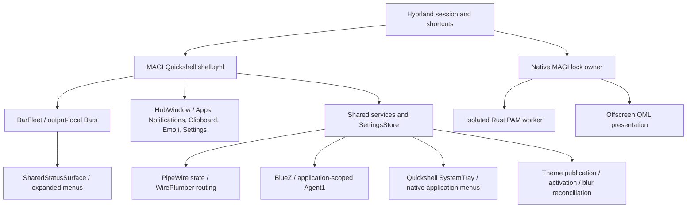

# Current MAGI architecture

> Phase 15 source/ownership review; validation limits are listed explicitly below.

Canonical overview, reviewed against production source in Phase 15 (2026-10-27).
Settings schema **22**. Source, tests and documentation live in `~/dotfiles/linux/magi`.
The chronological [architecture journal](../architecture.md) and phase records are
historical evidence, not instructions to deploy old candidates.

## Boundaries and owners

Paths in this table are relative to `.config/quickshell/magi`. A singleton is
registered in `services/qmldir`; the Bar does not create an independent system model
per output. External service state is not serialized into Settings.

| Owner | Responsibility / consumers | Persistent or generated state | External authority / activation |
| --- | --- | --- | --- |
| `shell.qml` | Lifetime root, BarFleet, Hub, toast hosts | None | Quickshell configuration load |
| `components/bar/BarFleet`, `OutputPolicy`, `SurfaceOrigin` | Enabled outputs, main output, invocation-time routing | Bar preferences only; screen objects are runtime | Quickshell screens / Hyprland focus |
| `MenuController`, shared/anchored surface components | Selection, back stack, geometry and dismissal | Runtime only | Bar click / IPC / CC navigation |
| `Hub`, `SettingsWindowState` | One utility host, retained Settings session and preview | Runtime selection/drafts | Hub shortcuts / utility links |
| `Settings`, `settings/SettingsStore`, schema/migrations and disk helper | Canonical preference validation, draft/save/conflict handling | Local untracked settings.json, backups/locks | Explicit edits; defaults and migrations on read |
| `Network` | Wi-Fi discovery, connection, password flow | NetworkManager owns connection credentials | Quickshell NetworkManager API; menus consume state |
| `Bluetooth`, `bluetooth_actions.py`, `bluetooth_backend.py` | Discovery and one pair/trust/connect coordinator, authentication prompts | BlueZ pairing/trust; no PIN persistence | QS device model + application-scoped Agent1 |
| `Audio`, `AudioModel` | Default sink/source and grouped playback volume | No MAGI route or stream persistence | PipeWire nodes; WirePlumber remains routing policy owner |
| `TrayService`, `TrayModel` | Shared reactive tray collection and runtime presentation override | None | Built-in SystemTray; no custom watcher |
| `Battery`, `Brightness` | UPower state and backlight adjustment | No independent preference store | UPower / brightnessctl |
| `QuickActions`, `system_actions.py`, `ActionConfirmation` | Power/VPN status and deliberate system actions | Runtime queue/confirmation only | System services; no action on status refresh |
| `AirplaneMode`, `Caffeine` | Radio intent; session idle inhibition | Runtime only | Network/Bluetooth and compositor inhibition |
| `ClockState`, `Calendar`, `CalendarModel`, `CalendarMath` | Time/date and calendar presentation | Calendar preferences | Local clock; shared date calculations |
| `Media`, `MediaController`, `PlayerSelection` | MPRIS player selection and transport | Preferred player preference | MPRIS; separate from audio routing |
| `Notifications`, `NotificationBackend/Model/Record`, `NotificationPolicy` | Server, history/expiry, toast policy | Session records and preference limits | Notification server activated by shell |
| `Clipboard`, clipboard backend/capture helper | Collection, search, restore and explicit persistence | Opt-in history; session data otherwise | Wayland clipboard; bounded worker |
| `Emoji`, `EmojiSearch` | Catalogue search and clipboard handoff | Recents/preferences | Bundled data; copy only on action |
| `Launcher`, `LauncherIcons`, `LauncherSearch`, launcher backend | XDG application catalogue, search, GIO launch | Hidden-app preferences, system desktop entries | GIO desktop semantics; detached standard streams |
| `Wallpaper`, wallpaper library/state/backend | Library, selected wallpaper, topology reconciliation | Wallpaper state/cache | Renderer backend; user choice and topology events |
| `AssetManager`, `assets.py`, `Weather`, `weather.py` | Managed asset import; optional weather cache | XDG assets/cache; location preference | Validated import; bounded opt-in network fetch |
| `ThemeOrchestrator`, theme backend/orchestrator/activation | Sole generated application-theme publisher; activate existing apps after publication | Ownership journal, generation store, activation receipts | Shell startup reconciliation / theme edits |
| `ApplicationAppearanceService`, application_appearance | Background-alpha intent composed through theme publisher; supported blur participation | Appearance journal | Settings intent and compositor validation |
| `GlobalBlurService`, `global_blur.py` | Global compositor blur amount with generation-aware restoration | Global blur journal | Hyprland remains compositor authority |
| `Displays`, displays model/planner/transaction | Topology preview and guarded transaction groundwork | Profiles/transaction state | Compositor; physical production completion deferred |
| `LockAuxiliary`, `lock_auxiliary.py` | Display-only weather/media snapshots | Private auxiliary state and bounded artwork cache | Shell publisher; native lock consumes snapshots |
| `native/lock` | Session lock ownership, native input, credential lifetime, PAM outcome | Deployed package and runtime lock state | Native owner alone authorizes unlock; QML cannot |

Optional terminal visuals use the same publisher and activation coordinator.
CAVA receives generated semantic colours via an anonymous launch configuration;
ascii-splash receives a nearest built-in theme argument. Guarded static Bash hooks
leave behavioral config untouched, with next-launch semantics and missing-state
fallback. Neither app is a dependency. See [support details](../review/terminal-visuals.md).

## Current interaction contracts

- Volume: left-click Audio, right-click mute, wheel bounded volume; output/input
  dropdowns and one slider per application group. Slider icons mute. Application
  grouping uses application ID, then binary, then name; unidentified nodes remain
  separate. Group volume displays the maximum and deliberate edits set all member
  streams. This fallback can group unrelated same-name applications (debt).
- Tray: placement defines default visibility. Super+T temporarily toggles icons
  directly in the main-output Bar, including temporary right-side placement when
  absent. No preference is written. Overflow remains an active bounded surface;
  it is not the retired shortcut popup. Native menus retain application ownership.
- Bluetooth: paired devices precede discovered devices. User pairing progresses
  through pair/trust/connect, with duplicate requests guarded and failures exposed.
- Bar reservation remains 48 logical pixels plus edge offset. Audio/Wi-Fi/Bluetooth
  use the originating output; keyboard invocation resolves focused enabled output
  then main. Tray remains main-output only. Hotplug closes invalid surfaces.
- Family/region selection edits shared style; item selection exposes identity and
  deliberate family disclosure. Bar preview stays full-width; Hub preview vertical.
- Semantic shell icons use MAGI packs; application/tray icons retain system artwork.
  Shared transparency affects backgrounds, not icons, text or credentials.

## Startup and reload invariants

`shell.qml` explicitly activates Notifications, Clipboard, Theme Orchestrator,
Application Appearance, Global Blur, Wallpaper, Weather and LockAuxiliary.
Audio/Tray/other singletons initialize through their consumers. Startup reconciles
owned state; it must not launch apps, activate tray items, connect Bluetooth or set
an audio route. Theme activation receipts prevent replay for already-current output.
Output references are actual screen objects, reconciled after removal.

The Phase 14B native reload acceptance remains historical evidence. Phase 15 makes one
minimal runtime correction: SettingsRow selects its responsive columns from parent
available width, avoiding a provisional implicit-width cycle. MAGI reloaded cleanly;
the operator accepted Profile, Bar, Apps, Audio, Bluetooth, Tray and Settings smoke
checks. No lock/auth, routing, pairing, launcher or tray runtime code changed.

## Review limits

This is a source/ownership review, not a formal security proof or hardware acceptance.
No whole-file resurrection from legacy worktrees was needed. No runtime QML deletion
is proposed: in particular TrayOverflow and the anchored fallback have live consumers.
See [technical debt](../technical-debt.md), [security](../security.md), and
[generated state](../generated-state.md) for the remaining boundaries and risks.

Theme integrations now recognize exact canonical static bootstrap blocks as read-only
source. Their journals own generated state, runtime links and selection rollback, not
removal of tracked hooks. The explicit legacy-journal conversion and per-application
fallbacks are described in [generated state](../generated-state.md).

## Terminal presentation

`magi-fetch` consumes the existing semantic palette and captures Fastfetch once.
It is an isolated terminal renderer, not a Quickshell service or theme publisher.
It reserves a bounded logo area, keeps system text fixed and restores terminal state.
Approved interactive Ghostty startup uses `--until-key` before ble.sh attaches; SSH, multiplexer and nested shells are skipped.
See [usage and terminal safety](../terminal-fetch.md).

## Isolated daily-use polish candidate

The [candidate record](../review/daily-use-polish.md) describes optional sparse Bar
item roles, one shared Battery region presenter and immediate media timer refresh.
Family ownership and per-output consumption remain unchanged. Native acceptance and
integration are pending; Zen's missing initial MPRIS duration remains external debt.
