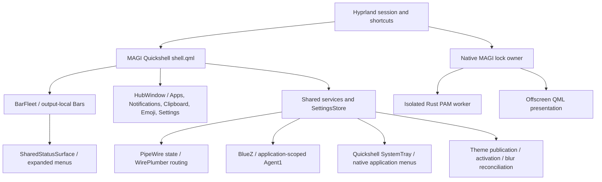

# Current MAGI architecture

> Post-0.57 source/ownership review; native evidence and remaining limits are explicit.

Canonical overview, reconciled against production `e251450` on 2026-11-05.
Settings schema **22**. Source, tests and documentation live in `~/dotfiles/linux/magi`.
The chronological [architecture journal](../architecture.md) and phase records are
historical evidence, not instructions to deploy old candidates.

## Boundaries and owners

Paths in this table are relative to `.config/quickshell/magi`. A singleton is
registered in `services/qmldir`; the Bar does not create an independent system model
per output. External service state is not serialized into Settings.

| Owner | Responsibility / consumers | Persistent or generated state | External authority / activation |
| --- | --- | --- | --- |
| `shell.qml` | Lifetime root, BarFleet, Hub, toast hosts | None | Quickshell configuration load |
| `components/bar/BarFleet`, `OutputPolicy`, `SurfaceOrigin` | Enabled outputs, main output, invocation-time routing | Bar preferences only; screen objects are runtime | Quickshell screens / Hyprland focus |
| `MenuController`, shared/anchored surface components | Selection, back stack, geometry and dismissal | Runtime only | Bar click / IPC / CC navigation |
| `Hub`, `SettingsWindowState` | One utility host, retained Settings session and preview | Runtime selection/drafts | Hub shortcuts / utility links |
| `Settings`, `settings/SettingsStore`, schema/migrations and disk helper | Canonical preference validation, draft/save/conflict handling | Local untracked settings.json, backups/locks | Explicit edits; defaults and migrations on read |
| `Network` | Wi-Fi discovery, connection, password flow | NetworkManager owns connection credentials | Quickshell NetworkManager API; menus consume state |
| `Bluetooth`, `bluetooth_actions.py`, `bluetooth_backend.py` | Discovery and one pair/trust/connect coordinator, authentication prompts | BlueZ pairing/trust; no PIN persistence | QS device model + application-scoped Agent1 |
| `Audio`, `AudioModel` | Default sink/source and grouped playback volume | No MAGI route or stream persistence | PipeWire nodes; WirePlumber remains routing policy owner |
| `TrayService`, `TrayModel` | Shared reactive tray collection and runtime presentation override | None | Built-in SystemTray; no custom watcher |
| `Battery`, `Brightness` | UPower state and backlight adjustment | No independent preference store | UPower / brightnessctl |
| `QuickActions`, `system_actions.py`, `ActionConfirmation` | Power/VPN status and deliberate system actions | Runtime queue/confirmation only | System services; no action on status refresh |
| `AirplaneMode`, `Caffeine` | Radio intent; session idle inhibition | Runtime only | Network/Bluetooth and compositor inhibition |
| `ClockState`, `Calendar`, `CalendarModel`, `CalendarMath` | Time/date and calendar presentation | Calendar preferences | Local clock; shared date calculations |
| `Media`, `MediaController`, `PlayerSelection` | MPRIS player selection and transport | Preferred player preference | MPRIS; separate from audio routing |
| `Notifications`, `NotificationBackend/Model/Record`, `NotificationPolicy` | Server, history/expiry, toast policy | Session records and preference limits | Notification server activated by shell |
| `Clipboard`, clipboard backend/capture helper | Collection, search, restore and explicit persistence | Opt-in history; session data otherwise | Wayland clipboard; bounded worker |
| `Emoji`, `EmojiSearch` | Catalogue search and clipboard handoff | Recents/preferences | Bundled data; copy only on action |
| `Launcher`, `LauncherIcons`, `LauncherSearch`, launcher backend | XDG application catalogue, search, GIO launch | Hidden-app preferences, system desktop entries | GIO desktop semantics; detached standard streams |
| `Wallpaper`, wallpaper library/state/backend | Library, selected wallpaper, topology reconciliation | Wallpaper state/cache | Renderer backend; user choice and topology events |
| `AssetManager`, `assets.py`, `Weather`, `weather.py` | Managed asset import; optional weather cache | XDG assets/cache; location preference | Validated import; bounded opt-in network fetch |
| `ThemeOrchestrator`, theme backend/orchestrator/activation | Sole generated application-theme publisher; activate existing apps after publication | Ownership journal, generation store, activation receipts | Shell startup reconciliation / theme edits |
| `ApplicationAppearanceService`, application_appearance | Background-alpha intent composed through theme publisher; supported blur participation | Appearance journal | Settings intent and compositor validation |
| `GlobalBlurService`, `global_blur.py` | Global compositor blur amount with generation-aware restoration | Global blur journal | Hyprland remains compositor authority |
| `Displays`, displays model/planner/transaction | Topology preview and guarded transaction groundwork | Profiles/transaction state | Compositor; physical production completion deferred |
| `LockAuxiliary`, `lock_auxiliary.py` | Display-only weather/media snapshots | Private auxiliary state and bounded artwork cache | Shell publisher; native lock consumes snapshots |
| `native/lock` | Session lock ownership, native input, credential lifetime, PAM outcome | Deployed package and runtime lock state | Native owner alone authorizes unlock; QML cannot |

Optional terminal visuals use the same publisher and activation coordinator.
CAVA receives generated semantic colours via an anonymous launch configuration;
ascii-splash receives a nearest built-in theme argument. Guarded static Bash hooks
leave behavioral config untouched, with next-launch semantics and missing-state
fallback. Neither app is a dependency. See [support details](../review/terminal-visuals.md).

## Current interaction contracts

- Volume: left-click Audio, right-click mute, wheel bounded volume; output/input
  dropdowns and one slider per application group. Slider icons mute. Application
  grouping uses application ID, then binary, then name; unidentified nodes remain
  separate. Group volume displays the maximum and deliberate edits set all member
  streams. This fallback can group unrelated same-name applications (debt).
- Tray: placement defines default visibility. Super+T temporarily toggles icons
  directly in the main-output Bar, including temporary right-side placement when
  absent. No preference is written. Overflow remains an active bounded surface;
  it is not the retired shortcut popup. Native menus retain application ownership.
- Bluetooth: paired devices precede discovered devices. User pairing progresses
  through pair/trust/connect, with duplicate requests guarded and failures exposed.
- Bar reservation remains 48 logical pixels plus edge offset. Audio/Wi-Fi/Bluetooth
  use the originating output; keyboard invocation resolves focused enabled output
  then main. Tray remains main-output only. Hotplug closes invalid surfaces.
- Family/region selection edits shared style; item selection exposes identity and
  deliberate family disclosure. Bar preview stays full-width; Hub preview vertical.
- Semantic shell icons use MAGI packs; application/tray icons retain system artwork.
  Shared transparency affects backgrounds, not icons, text or credentials.

## Startup and reload invariants

`shell.qml` explicitly activates Notifications, Clipboard, Theme Orchestrator,
Application Appearance, Global Blur, Wallpaper, Weather and LockAuxiliary.
Audio/Tray/other singletons initialize through their consumers. Startup reconciles
owned state; it must not launch apps, activate tray items, connect Bluetooth or set
an audio route. Theme activation receipts prevent replay for already-current output.
Output references are actual screen objects, reconciled after removal.

The Phase 14B native reload acceptance remains historical evidence. Phase 15 makes one
minimal runtime correction: SettingsRow selects its responsive columns from parent
available width, avoiding a provisional implicit-width cycle. MAGI reloaded cleanly;
the operator accepted Profile, Bar, Apps, Audio, Bluetooth, Tray and Settings smoke
checks. No lock/auth, routing, pairing, launcher or tray runtime code changed.

## Review limits

This is a source/ownership review, not a formal security proof or hardware acceptance.
No whole-file resurrection from legacy worktrees was needed. No runtime QML deletion
is proposed: in particular TrayOverflow and the anchored fallback have live consumers.
See [technical debt](../technical-debt.md), [security](../security.md), and
[generated state](../generated-state.md) for the remaining boundaries and risks.

Theme integrations now recognize exact canonical static bootstrap blocks as read-only
source. Their journals own generated state, runtime links and selection rollback, not
removal of tracked hooks. The explicit legacy-journal conversion and per-application
fallbacks are described in [generated state](../generated-state.md).

## Terminal presentation

`magi-fetch` consumes the existing semantic palette and captures Fastfetch once.
It is an isolated terminal renderer, not a Quickshell service or theme publisher.
It reserves a bounded logo area, keeps system text fixed and restores terminal state.
Approved interactive Ghostty startup uses `--until-key` before ble.sh attaches; SSH, multiplexer and nested shells are skipped.
See [usage and terminal safety](../terminal-fetch.md).

## Daily-use media and status styling

The [review record](../review/daily-use-polish.md) describes optional sparse Bar
item roles and palette-relative shade refinement, one shared Battery region presenter
with centered content, and immediate media timer refresh. Family ownership and
per-output consumption remain unchanged. Zen's missing initial MPRIS duration remains
external debt; no fabricated duration or playback manipulation is introduced.

Expanded status headers resolve a shared appearance role/shade independently of
collapsed Bar foregrounds. Existing shared expansion drives the colour transition;
Battery icon and percentage use the same resolver. No ownership or geometry change.

## Accepted lock and fingerprint integration

The [current implementation](../review/lock-fingerprint-production.md) runs a bounded,
owner-pinned fprintd broker beside the independent PAM worker. Controller validates
a one-shot current binding before the existing unlock/sync path. Presentation remains
read-only, with stable corner geometry, confirmed native power intent, density-aware
buffers and bounded media refresh. Installed 0.1.0-11 follows the accepted presentation refinement; the integration passed internal visual, normal
fingerprint/password and suspend/resume acceptance. Physical external-monitor acceptance is deferred.

## Curated lock screen theme layer (2026-10-30 accepted)

[Theme model, Settings workflow and compatibility](../review/lock-screen-themes.md) describe six curated compositions over the existing
layout engine. The designer is developer-gated; normal Settings is a gallery and a
small relevant editor. Schema 22 and authentication/service ownership are retained.
Internal native acceptance passed; physical external-monitor acceptance remains
deferred. Evidence and compatibility details are in the review record.

## Accepted Hyprland 0.57 compatibility

The [adapter audit and native acceptance gate](../review/hyprland-057.md) records the bounded
0.56–0.57 Lua border API policy, verified runtime readback, generated-state status
and unchanged XDG/bootstrap ownership. Native host acceptance passed with exact border readback and Nord restoration;
The operator approved closeout. Settings schema stays 22.

## Accepted Intel blur integration (2026-11-05)

Ghostty alpha plus compositor-owned blur passed native A/B with blur retained and
improved typing/workspace responsiveness. The integration retains MAGI's painted
regions: Lua layer rules looked correct but used more compositor engine time with
no observed responsiveness benefit. The Ghostty launch integration and 0.57 effects
fix are deployed and passed normal-launch and theme-switch/restore acceptance
after a full Ghostty quit/reopen. The reload executor identifies the real binary
behind the wrapper and retains its existing D-Bus owner guards. The implementation is committed at `e251450`. See [evidence and limits](../research/intel-blur-architecture.md).

## Session and configuration ownership

The accepted T15g session uses BIOS Hybrid Graphics, Intel compositor rendering and
NVIDIA application/game offload. There is no production NVIDIA-first environment
or alternate session launcher. Login remains `.bash_profile` → `start-hyprland` →
Hyprland Lua → the full MAGI shell; HyprMon owns its local monitor profile output.
The internal panel is 3840×2160 at 60 Hz, scale 2 (1920×1080 logical pixels).

Consolidation preserves the already accepted panel-description match and numeric
scale 2 in canonical `linux/t15g/hypr/.config/hypr/hyprland.lua`. The approved
`~/.config/hypr` repair now resolves directly to that canonical directory. All four
effective config files retain their accepted bytes, including HyprMon's local profile.
The border enrollment identity was reconciled under its journal lock, without reload.
Native readback confirms unchanged 4K/60 Hz/scale 2, zero config errors and Live border
activation. The earlier monitor audit remains evidence, not a live dependency.

Theme targets are MAGI, Hyprland borders, Ghostty, GTK/Thunar, Zen, Yazi/yatline,
Neovim, Starship, Fastfetch, btop, CAVA and ascii-splash. Both border activation and
the independent appearance/blur controls accept audited stable Hyprland 0.56/0.57
Lua releases, with instance/configuration/readback guards and fail-closed unknown
versions. Current generation/publication errors take precedence over an older
successful activation receipt; receipts remain retained for activation accounting.

Ghostty owns background alpha; Hyprland owns its backdrop blur. The application
wrapper adds only the GTK protocol opt-out and preserves arguments/other environment,
including PRIME settings. The desktop entry uses that wrapper and native single-instance
handling. Reload discovery resolves the wrapper's real executable and validates its
D-Bus owner. MAGI keeps its precise BackgroundEffect regions, with no Lua layer-rule
replacement. GlobalBlur owns size only; four passes/optimizations remain static policy.

The normal Lock Screen page offers Split Corners, Centered, Minimal, Editorial, Media
and Compact, using current wallpaper previews. Legacy Custom remains preserved.
`MAGI_LOCK_DESIGNER=1` exposes the existing internal designer; it is not a second
normal product route. Fingerprint Settings management and the native lock broker
remain separate consumers of fprintd; only the native owner/PAM or current validated
broker result can authorize unlock. No authentication code changed in consolidation.
