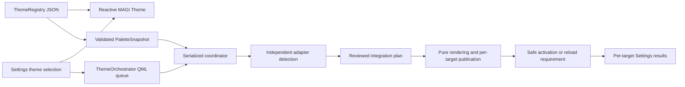

# System Theme Orchestrator — v1

> Phase 2E.1 supersedes legacy-tool references below: MFTrunk and Rofi are retired; MAGI Apps is the sole launcher route. Earlier references record historical state.

Implementation date: **2026-10-14**, refined **2026-10-15**. **Uncommitted operator
review; accepted targets and remaining checks are recorded below.** Baseline: `6f36b52` (`docs: research MAGI theme
orchestration`), following wallpaper checkpoint `f21d567`.

The authoritative source is [the coverage/architecture research](../research/theme-orchestrator-coverage.md).
That historical evidence is unchanged. No broad audit or external project research
was repeated. Local installed API metadata, command help and native parsers answered
implementation-specific questions.

## Enrollment UX correction — operator follow-up

The production AppearancePage used to immediately reset an unchecked target's
checkbox after requesting a preview, while placing confirmation below all thirteen
rows. At the normal Settings size the pending action was off-screen. Local probing
and the new pointer test found available/configured checkboxes technically enabled;
the misleading reset/hidden confirmation reproduced the apparent dead end. The
additional `configured` gate could also silently disable an installed target with
missing config without showing its reason. The earlier QML test instantiated the
page but called `preview()` and `enable()` directly: it verified the service path,
not checkbox interaction or confirmation visibility. Its earlier “enrollment UI”
claim was too broad.

Follow MAGI now opens a bounded confirmation directly inside the selected row,
scrolls that row into view, and visibly retains the pending check. Confirm installs
that exact plan; Cancel or failure restores unchecked. Available and unenrolled
is interactive; unavailable is disabled with a reason. Missing audited config is
reported as Setup required and fails safely during planning. Status colours and
text distinguish available, following, paused, busy and unavailable states. Errors
are attached to the target, including preview/precondition failures. Disable still
stops future writes before conservative hook removal. First-activation failure
pauses following and retains tracked integration for retry/removal; checking again
resumes only after existing ownership checks pass.

The exact previously confirmed Zen profile is an explicit adapter enrollment
allowlist entry. Discovery returns it only when registration metadata still resolves
to that exact path. Its checkbox no longer requires pasting the same confirmation.
An alternative profile still requires explicit confirmation; no first-match or
all-profile enrollment was introduced.

`tests/theme-orchestrator/pointer.qml` uses QtTest `mouseClick` on the production
AppearancePage at its normal 750×720 content size, with the real worker and isolated
HOME/XDG roots. It checks opt-in, automatic confirmation visibility, cancellation,
plan-race failure returning unchecked, successful enrollment, disable, unavailable
and missing-config states, confirmed-profile Zen and changed-hook refusal. The
runner also checks that user-modified Ghostty content survives and Zen CSS is
restored. The final refinement expands this to **15** backend tests and production
Copy coverage. This is injected pointer testing; desktop acceptance is recorded
separately below. Tests enroll only disposable fixtures; no commit or push.

## Architecture and canonical palette

`theme/palettes/registry.json` remains the source for ThemeRegistry, the reactive
MAGI UI and the independent Python resolver. All **ten** existing themes remain:
Catppuccin Mocha/Macchiato/Frappé/Latte and Everforest dark/light hard/medium/soft.
The existing Appearance selector and Settings IPC remain the selection interface.



`PaletteSnapshot` schema 1 is JSON with `id`, `label`, actual `dark` boolean,
all 33 validated `roles`, `ansi[16]`, terminal foreground/background/cursor/selection
pairs, syntax roles, diagnostics, graph ramp and a deterministic SHA-256
`fingerprint`. Colour values are six-digit RGB hex. ANSI uses explicit semantic
mappings and family-specific Catppuccin magenta; bright chromatic entries deliberately
retain their reviewed family colours. It does not invent light versions or infer
ANSI colours from one accent. Font, opacity, geometry, icons and cursors are separate. Theme Orchestrator owns
colour identity, not unrelated application/compositor behaviour: blur, effects,
animation strength, layout and feature settings remain operator-owned.
The QML coordinator resolves the same unknown-ID fallback as ThemeRegistry.

Modules under `services/theme_orchestrator/` separate palette validation, storage,
coordination, registry and adapters. `theme_backend.py` accepts one JSON request
through stdin. No shell command interpolation, fetched templates or generator
dependencies. Existing Quickshell 0.3.1 `Process`, `StdioCollector`, `FileView` and
`Connections` patterns are retained. The host activates the coordinator once;
rapid selection changes retain the newest pending palette, with stale UI results
rejected. A filesystem lock serializes separate workers. Each target publishes
independently, so one failed renderer/activation does not roll back other targets.

## State and Settings

Appearance gains a modest System Theme section: detected targets, Follow MAGI
Theme, per-target result, published palette, errors and Retry. Turning on a target
first displays an exact import/configuration diff inside that row; **Enable Follow MAGI Theme**
installs that concrete plan. A changed plan/hash requires a fresh preview. Detection
alone never enrolls an application. External targets default off; MAGI is always on.

Preferences/ownership are durable in the external orchestrator journal, not in
operator-local `settings.json`; no Settings schema migration or implicit rewrite
was needed. A target records enabled, installed, phase, desired/published/applied
palette, generation, result, stage and bounded error. Probe results include
availability, configured state, exact config/resolved path and the audited
compatibility description. Only Hyprland runtime activation is version-gated;
other compatibility labels document the audited versions, not a claim of arbitrary
future version support. `STARSHIP_CONFIG`, `YAZI_CONFIG_HOME` and `NVIM_APPNAME`
overrides selecting an unaudited configuration prevent enrollment.

Published does **not** mean visually applied. MAGI reports its reactive selection;
Hyprland reports runtime acceptance and `configerrors`, never visual confirmation.
Other applications retain explicit reload/next-launch/restart outcomes. Enabled
failures produce a **Partial failure** summary. No global “system applied” claim.
Starship's base file is watched so subsequent base edits request recomposition;
unchanged generated bytes do not rewrite/reload a target.

## Generated ownership and recovery

Let `D = $XDG_DATA_HOME/magi/theme-orchestrator` (default
`~/.local/share/magi/theme-orchestrator`) and
`S = $XDG_STATE_HOME/magi/theme-orchestrator` (default
`~/.local/state/magi/theme-orchestrator`). For each target:

- `D/<id>/.magi-owner` identifies MAGI's directory.
- `D/<id>/generations/<sha256>/` holds rendered files, `palette.json` and
  `.manifest.json` containing their hashes.
- `D/<id>/current` is the stable atomic symlink used by integration hooks;
  `previous` retains the prior generation. Publication is per target, not an
  assertion of cross-application atomicity.
- `S/state.json` records narrow edited spans/context, before/after hashes, path
  and symlink identity, GSettings predecessor/last value and phase. It does not
  back up entire `.bashrc` or browser preferences. `S/lock` serializes workers.

Storage rejects symlinked output roots, known Git/Stow source locations and
redirected generated paths. Integration edits may deliberately resolve an audited
Stow symlink once; runtime palette publication never writes generated files there.
Output is privately created and atomically published. Existing integration file
permissions are retained. Edited generated artifacts cause a conflict. Cleanup
keeps current/previous, deleting only journal-listed obsolete generations with an
intact ownership manifest and exact file hashes. Altered/unrecognized artifacts
are retained, even if that exceeds two generations.

Enrollment journals intent before installing hooks. Interrupted enrollment stays
visible, disabled, with a Remove hooks recovery path. Disable first persists
`enabled=false`, then removes only exact owned spans/links/settings. Unrelated later
edits survive; edits inside a managed span/context or changed symlinks cause a
conflict, never a whole-file restoration. Changes made by an independently writing
application cannot be made transactionally atomic with MAGI; compare-before-write
and conservative refusal are the boundary. Do not enroll btop while it is saving
its configuration.

Disabling retains generated data and the last published identity for diagnosis.
It does not delete app-owned themes or claim to undo colours already loaded by a
running process. Selecting the earlier MAGI palette regenerates/republishes it
through the same activation contract; a browser still needs restart. Data rollback,
removal of imports and visual rollback are different operations. No automatic
browser/editor/session restarts occur.

## Adapter registry, exact artifacts and hooks

All paths below are relative to the active XDG config root `C` unless stated.
Integration diffs are produced dynamically and reviewed in Settings, not silently
installed by discovery. Operator enrollment has since installed working integrations;
this refinement preserves their enabled/installed state without re-enrollment.

| Stable ID | Generated artifacts below `D/<id>/current` | Only integration ownership | Activation / status |
|---|---|---|---|
| `magi` | None | Existing Settings/ThemeRegistry selection | Reactive MAGI palette; no shell restart |
| `hyprland` | `colors.lua` | Marked late colour-only Lua loader in audited `C/hypr/hyprland.lua` | Hyprland 0.56.x: targeted `hyprctl eval`, then `hyprctl configerrors`; unreachable IPC is failure, not applied |
| `ghostty` | `colors.conf` | Marked optional `config-file = ?<absolute path>` at end of `C/ghostty/config.ghostty` | Reload required using `reload_config`; installed default binding verified as Ctrl+Shift+,; no PID signalling |
| `gtk` | `gtk.css`, `theme/gtk-3.0/gtk.css` | Marked import and migration of audited colour declarations in `C/gtk-3.0/gtk.css`; marked `gtk-theme-name=MAGI` in GTK3 `settings.ini`; owned `$XDG_DATA_HOME/themes/MAGI` symlink; GSettings `org.gnome.desktop.interface` keys `gtk-theme` and `color-scheme` with saved predecessors | Named GTK3 theme, bounded Thunar palette, system scheme request; relaunch Thunar required; GTK4 full CSS deferred |
| `zen` | `chrome.css` | One marked leading import in the confirmed profile's `chrome/userChrome.css` | CSS generated; manual workspace base colour; restart Zen after CSS changes |
| `yazi` | `flavor/flavor.toml`, `yatline.lua` | `C/yazi/flavors/magi.yazi` symlink; marked flavour selector and commented migrated colour style objects/filetype rules in `theme.toml`; marked palette loader and role references replacing audited literal strings in `init.lua` | Next Yazi launch; both flavour and yatline follow |
| `neovim` | `colors/magi.lua` | Marked late runtimepath/`:colorscheme magi` loader in `C/nvim/init.lua` | Existing instances: `:colorscheme magi`; otherwise next launch |
| `starship` | `starship.toml` | One marked `STARSHIP_CONFIG` export in `~/.bashrc`; `C/starship.toml` remains read-only base | Next prompt after environment adoption; existing shells need a new shell or the single export, not sourcing all bashrc |
| `fastfetch` | None | None; audited `C/fastfetch/config.jsonc` retained | Next invocation after Ghostty palette reload; ANSI inheritance. Reports dependency failure if Ghostty is not enabled/generated for this palette |
| `btop` | `magi.theme` | Marked replacement of only `color_theme` in local `C/btop/btop.conf` | Reselect theme in btop or reopen; no invented reload signal |

Every rendered target additionally owns `palette.json` and `.manifest.json` as
listed above. Symlink integration entries contain no generated bytes in a Stow
tree. Empty parent directories created for an integration can remain after removal;
MAGI does not recursively clean application directories.

Fastfetch is a required visible v1 target with an inheritance adapter, **not** a
second configuration writer: its audited named green/yellow/ANSI display already
follows the terminal. Turning that row off stops MAGI handling/reporting for it;
it cannot prevent Fastfetch from inheriting terminal colours. No identity artwork
is recoloured.

Neovim covers normal/transparent backgrounds, floats, syntax/Treesitter links,
search/selection, diagnostics, diff, terminal ANSI, neo-tree, Telescope, lualine's
auto colour inputs, bufferline, which-key, indent guides and Alpha. Existing plugin
options, transparent Normal background and plugin installation remain unchanged.
These are explicit role mappings, not promises about every optional plugin group.
Yazi retains non-colour layout and reset-background choices; its separate preview
syntax theme remains an explicitly unthemed surface.

## GTK ownership decision

GTK3 now has one documented opt-in route: a generated **MAGI** named theme imports
GTK's installed Adwaita light/dark resource and adds scoped Thunar roles. Enrollment
sets both GTK3's theme name and the GSettings GTK theme to MAGI. The original
conflicting Catppuccin names are preserved in the removal journal. Known Thunar
literal colour declarations move into the named theme while non-colour CSS stays.
The user CSS import contains only MAGI symbolic definitions; it does not force
MAGI widget colours over a later HighContrast theme. Existing HighContrast prevents
enrollment; subsequent appearance-setting changes conflict and stop palette writes.

GTK4 `settings.ini`, GTK4 CSS, legacy GTK2, local Thunar xfconf, Papirus icons and
cursor settings are untouched. The shared `color-scheme` key follows actual dark/
light metadata. That is a system preference request, not proof that libadwaita or
a GTK4 application obeyed it. Full libadwaita repaint is deferred. Actual Thunar
palette behaviour is operator-accepted. Blue folder icons belong to the icon
theme and are not a palette-integration defect.

## Zen profile and privacy

The resolver uses only `~/.zen/profiles.ini`, `installs.ini` and the audited native
installation `15B76BAA26BA15E7`. Both installation defaults must agree and resolve
to exactly one registered existing profile. The unrelated general `Default=1`
profile is never selected by first match. A metadata change requires new enrollment.

The operator confirmed in this conversation that `about:support` reports
`/home/jkebwdn/.zen/0rzna1o3.Default (release)`. The checkbox uses that explicit confirmation when metadata still matches; a new
profile requires a new explicit confirmation.
The adapter checks only the custom-stylesheet enablement preference; it does not
write preferences. No history, cookies, passwords, sessions, bookmarks, workspace
state or website content is read or modified.

The leading CSS import is legal before rules. Generated `chrome.css` contains
only one `:root` rule and three important aliases consumed by the operator's
existing menu styling:

| Owned custom property | Canonical semantic role |
| --- | --- |
| `--ctp-base` | `roles.background` |
| `--ctp-surface0` | `roles.surface` |
| `--ctp-text` | `roles.text` |

The operator's unused `--ctp-mantle` definition remains untouched. No generated
native toolbar/sidebar/tab selectors, `--zen-*` or lightweight-theme variables
remain. Existing userChrome structure/layout, userContent, native themes, compact
sidebar behaviour, extensions and Mods remain operator-owned. Generated aliases
use existing specificity with important values solely to override the existing
non-important alias definitions, not to fight native Zen chrome.

The native workspace base is manual in v1. `ThemeOrchestrator.zenWorkspaceColor`
resolves the selected ThemeRegistry palette's semantic background dynamically,
without per-theme tables: Mocha is `#1e1e2e`, Everforest Dark Hard `#272e33`.
This updates immediately with theme selection, including every other registered
palette. Settings shows “Set this Zen workspace's base colour to <hex>” when
following, and a small Copy button. Copy invokes the existing clipboard backend's
bounded JSON/stdin `--copy-text` entry point, sending only the hex (no newline or
prose); completion/error feedback is scoped to the copied colour.

Status is **CSS generated · Manual workspace colour required · Restart Zen after
CSS changes**. File publication is not proof of CSS loaded or native colour set.
The native base belongs to the workspace being edited, not a global profile
colour. The separate profile-wide `zen.theme.accent-color` preference is not
modified. No browser session/workspace store, native gradients, preferences,
Mods, browser data or unsupported internal APIs are used to automate the picker.
See [the preserved investigation](../research/zen-native-theme-boundary.md).

The stable owned hook remains the leading marked import of
`file:///home/jkebwdn/.local/share/magi/theme-orchestrator/zen/current/chrome.css`
in `/home/jkebwdn/.zen/0rzna1o3.Default (release)/chrome/userChrome.css`.
Normal restart adopts CSS changes. Disabling stops generation and removes only
the intact owned import; changed hooks conflict and remain untouched. Already
loaded CSS requires restart to unload. Manual native colour is never reset.

## Intentionally retained inconsistencies / deferred targets

Qt, hyprtoolkit and Hyprlock are visible deferred registry entries with audit-based
reasons: Qt's active platform integration is unverified; hyprtoolkit helper/auth
surfaces have no established operator-owned configuration boundary; Hyprlock is
protected and temporary pending the planned first-party MAGI Lock Screen.
No new adapters are implemented. Protected Hypridle/Hyprlock files remain untouched. GTK2 and complete GTK4/
libadwaita repaint, browser workspace gradients/content, Yazi preview syntax and
additional Neovim plugin groups are not represented as complete coverage.

Original Hyprland/Ghostty colours and the Neovim Catppuccin setup remain fallback
configuration beneath the late generated hook. This is intentional reversible
ownership: while enrolled, generated values take precedence; removing the hook
restores the user's base on the next reload. Starship's old palette remains in its
read-only base, with the composed generated config selecting the MAGI palette.
GTK/Yazi colour declarations requiring migration are preserved as comments or
narrow journal spans for removal. No artwork or source registry colours were removed.

The audit also proposed ble.sh, fzf and Rofi. They are outside the user's enumerated
v1 application set and remain unimplemented, explicitly leaving their true-colour
faces/menu palette inconsistent. MFTrunk artwork and WallpaperTile's dark
image-legibility overlay are intentionally unchanged. Icons/cursors do not follow
palette switching. No unsupported installed application was enrolled.

Wallpaper retains the existing `selectionChanged(path, monitor, assignments)` and
confirmed state extension point. Nothing subscribes to it for theme changes in
v1. A future palette generator can submit a validated registry/snapshot request;
wallpaper and theme selection remain independent. No extraction, scheduling,
day/night automation, lock/greeter or shell redesign was introduced.

## Validation and acceptance — final v1 refinement

Operator-accepted: MAGI reactive palette; Hyprland border switching with restored
neutral shadows and no recurring glow; Ghostty Ctrl+Shift+, reload; GTK/Thunar
palette; newly launched Yazi. Hybrid Zen native workspace colouring and expanded
compact sidebar were successfully tested with Everforest and Catppuccin. These
acceptances are retained; a complete repeat cycle is not required.

Passed in this refinement:

- `python tests/theme-orchestrator/run.py`: **15** focused tests, including
  Mocha ↔ Everforest, all registered palettes/light metadata, lifecycle,
  reproducibility/idempotence, failure isolation, edited-output/hook protection,
  no generated Stow writes, persistence, minimal Zen CSS and private-state access
  guards. The Hyprland Lua spy rejects every non-border config write across
  Dark Soft/Hard, Light Hard, Frappé/Mocha in both directions.
- `python tests/theme-orchestrator/qml.py`: actual production checkbox/pointer
  path, enabled/unenrolled/unavailable states, inline confirmation/cancel,
  enrollment failure, disable and edited hooks; real Settings window and worker
  integration. Zen Copy pointer tests invoke the real clipboard helper with a
  disposable wl-copy sink; exact hex-only payloads match all ten backgrounds.
  The operator clipboard is not changed by these tests.
- `python tests/settings/appearance.py`: ten palettes, contrast and reactive
  Appearance controls. `python tests/settings/run.py`: schema/migrations,
  persistence/conflicts and actual Settings store.
- `python tests/theme-orchestrator/native.py`: Lua parser, Ghostty effective RGB,
  Starship prompt on Mocha → Everforest → Mocha; native Yazi/yatline PTY colour
  output. Headless Neovim highlights also pass in the focused suite.
- Repository-wide `git diff --check`: clean after the scoped Yazi correction.

`hyprctl configerrors` was attempted but IPC remains inaccessible here:
`Couldn't set socket timeout (2)`. This is not a new compositor failure or a
revocation of operator acceptance. Offscreen QML tests allow only the documented
sandbox IPC/network failures; they do not establish desktop visual behaviour.

No common shell state/geometry implementation changed in this refinement, so no
unrelated shared-surface suite was rerun. The exactly 48px reservation, Control
Centre, Calendar, Hub, Wallpaper Manager, Notifications and Clipboard implementation
remain unchanged. Native reservation/interactions were not remeasured here.

Remaining operator check: once updated Settings is loaded, check Zen's colour row
and Copy once, and restart Zen normally to adopt the reduced alias-only CSS; a
brief menu/sidebar sanity check suffices. The previously accepted Everforest/
Catppuccin native-picker cycle does not need repeating. Neovim, Starship, Fastfetch
and btop retain their existing next-launch/reload statuses; no new operator visual
acceptance for those is asserted.

## Operator-local state and Git allowlist

The original handoff left targets unenrolled; subsequent operator enrollments are
preserved. This pass published only Zen's new generated CSS/metadata under the
existing XDG store and updated its result in the ownership journal. userChrome
was verified byte-identical; no browser workspace/session data was read or written.
Settings JSON, Hyprland/Ghostty/GTK configs, and protected Hypridle/Hyprlock were
not modified by this pass.

Yazi's seven trailing spaces were introduced by the milestone's blank-line
`# MAGI flavour owns: ` comments, not pre-existing source whitespace. Only those
spaces were removed from `../t15g/yazi/.config/yazi/theme.toml`; the renderer now
avoids producing them. Under the store lock, the exact prior ownership hash was
checked, and the journal's edit record was recomputed with the same original
rollback content. Removal was verified to reconstruct that original exactly.
No target was disabled, enabled or re-enrolled. Generated Yazi output was not changed.

**Exact intended Git allowlist**, relative to `linux/magi/` in the dotfiles repo:

```text
.config/quickshell/magi/components/settings/pages/AppearancePage.qml
.config/quickshell/magi/services/ThemeOrchestrator.qml
.config/quickshell/magi/services/qmldir
.config/quickshell/magi/services/theme_backend.py
.config/quickshell/magi/services/theme_orchestrator/__init__.py
.config/quickshell/magi/services/theme_orchestrator/palette.py
.config/quickshell/magi/services/theme_orchestrator/storage.py
.config/quickshell/magi/services/theme_orchestrator/coordinator.py
.config/quickshell/magi/services/theme_orchestrator/adapters/__init__.py
.config/quickshell/magi/services/theme_orchestrator/adapters/base.py
.config/quickshell/magi/services/theme_orchestrator/adapters/desktop.py
.config/quickshell/magi/services/theme_orchestrator/adapters/zen.py
.config/quickshell/magi/services/theme_orchestrator/adapters/terminal.py
.config/quickshell/magi/services/theme_orchestrator/adapters/neovim.py
.config/quickshell/magi/shell.qml
tests/theme-orchestrator/run.py
tests/theme-orchestrator/qml.py
tests/theme-orchestrator/integration.qml
tests/theme-orchestrator/pointer.qml
tests/theme-orchestrator/native.py
docs/design/theme-orchestrator.md
docs/research/zen-native-theme-boundary.md
docs/README.md
docs/architecture.md
docs/decisions.md
docs/quickshell-reference.md
```

Exclude the pre-existing modified `.config/quickshell/magi/settings.json`, the
operator-local `../t15g/hypr/.config/hypr/hypridle.conf` and `hyprlock.conf`, runtime
state/generated files, and all unrelated changes. Also exclude the operator's
installed integration state in these tracked Stow sources from the implementation
commit (their ownership journal is local and must remain paired with them):

```text
../t15g/bash/.bashrc
../t15g/ghostty/.config/ghostty/config.ghostty
../t15g/gtk3/.config/gtk-3.0/gtk.css
../t15g/gtk3/.config/gtk-3.0/settings.ini
../t15g/hypr/.config/hypr/hyprland.lua
../t15g/nvim/.config/nvim/init.lua
../t15g/yazi/.config/yazi/init.lua
../t15g/yazi/.config/yazi/theme.toml
../t15g/yazi/.config/yazi/flavors/magi.yazi
```

These are deliberately installed operator hooks, not additional implementation
files to stage. Do not delete or revert them. Both research reports are preserved;
the new Zen report is included in the allowlist without rewriting its history.
No staging, commit or push. Stop for operator review.

## Hyprland shadow correction — 2026-10-15 (historical fix record)

Subsequent operator acceptance: the one-time neutral restoration was applied;
glow disappeared, windows look correct, and later theme switches affect borders
without reintroducing glow. The pending statements below record the earlier
execution-environment limitation, not current operator acceptance.

Operator acceptance rejected palette-coloured window glow. The committed and
working Hyprland decoration blocks agree: shadow enabled=true, range=20,
render_power=2, colour `rgba(00000059)` (black, approximately 35% alpha).
No separate inactive shadow colour is configured. Blur remains enabled, size=8,
passes=4, ignore_opacity=true, new_optimizations=true, xray=false,
brightness=0.90, contrast=0.92, noise=0.015, vibrancy=0.15,
vibrancy_darkness=0.50; rounding remains 8. The adapter never wrote window opacity.

The previous generated Lua replaced shadow RGB with palette background, retaining
alpha `59`. This made bright backgrounds produce a glow despite unchanged
range/power/opacity. The renderer now writes only active/inactive border colours;
shadow RGB/alpha and all decoration/effect parameters remain operator-owned.
There is no recurring forced-black override or palette-specific shadow tuning.
Optional themed window glow is deferred, not implemented.

All 13 focused lifecycle/parser tests pass. A new regression executes the actual
generated Lua for Everforest Dark Soft/Hard, Everforest Light Hard, Catppuccin
Frappé/Mocha, forward and reverse. Its config-write spy validates both border
values and the complete allowed key structure, rejecting every non-border write.
It also verifies the operator config stays byte-identical during switching.
Fixtures now use committed pre-enrollment configs and isolate STARSHIP_CONFIG,
so operator enrollment does not contaminate the tests.

The corrected current Mocha generation was published through the normal
ownership-checked Hyprland-only retry. Only MAGI's generated XDG output and journal
were updated outside the checkout; operator configs and Settings were untouched.
Activation, a one-time targeted neutral-shadow restoration, and
`hyprctl configerrors` failed with `Couldn't set socket timeout (2)`.
No compositor reload was issued. Native focused/unfocused visual acceptance for
all five palettes remains pending; these automated checks are not visual proof.

Omitting shadow from new runtime updates cannot reset an already-loaded glow.
The one-time restoration on the operator's desktop is:

```sh
hyprctl eval 'hl.config({decoration={shadow={color="rgba(00000059)"}}})'
hyprctl configerrors
```

This restores only the audited colour/alpha. A normal subsequent compositor
configuration load also restores the user's neutral shadow because the generated
include no longer overrides it. Theme switching alone does not reset old state.

Correction allowlist: `.config/quickshell/magi/services/theme_orchestrator/adapters/desktop.py`,
`tests/theme-orchestrator/run.py`, `docs/design/theme-orchestrator.md`,
`docs/README.md`. Unrelated working changes are preserved. No commit or push.
