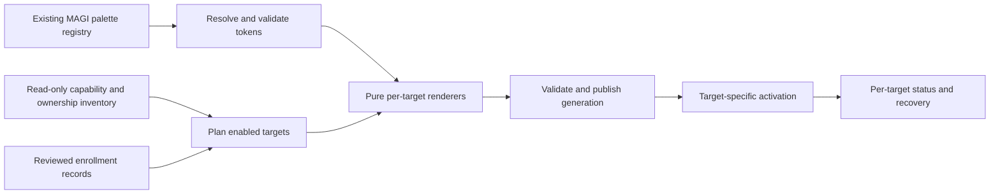

# Theme Orchestrator coverage audit

> Phase 2E.1 supersedes legacy-tool references below: MFTrunk and Rofi are retired; MAGI Apps is the sole launcher route. Earlier references record historical state.

Date: **2026-10-13**. Status: **research only; awaiting operator review**.

This audit identifies palette consumers on the current Arch/Hyprland installation. It does not implement Theme Orchestrator, change application configuration, reload applications, install packages, extract wallpaper palettes, or alter browser data. Only this report was created. The README and historical checkpoints were deliberately left unchanged.

Repository baseline: `f21d567d254060a902d3d8b70b446f60cd4f09c7`, `magi: add first-party wallpaper manager`; branch `main`, tracking `origin/main`, locally ahead by one commit. Existing operator-local `settings.json`, `hypridle.conf` and `hyprlock.conf` remain untouched and unstaged. No commit or push is part of this audit.

## Evidence and limits

Evidence comes from the tracked file list, resolved configuration symlinks, selected active XDG configuration, the installed package database, desktop entries, installed documentation/resources and upstream documentation. “Configured” below means there is a concrete configuration, launch binding, default-app association or autostart reference. It does **not** assert that an application currently has an open window.

The execution environment identifies the desktop as Hyprland but does not expose the host process list or usable compositor IPC. A read-only `hyprctl` query failed with `Couldn't set socket timeout (2)`. Consequently, actual live colours, process environments, service activity and runtime reloads could not be verified. Do not interpret missing sandbox processes as inactive host applications. Read-only GSettings queries returned persisted values with dconf runtime-directory warnings; live notification delivery remains unverified.

Zen inspection was restricted to profile registration, lock-file metadata, theme-related preferences, stylesheet files, theme-addon metadata and installed browser resources. History, passwords, cookies, sessions, workspace state and browsing content were **not** read. Profile paths are included because adapter ownership depends on them; no browser account or browsing data is included.

No regression suites were run: there is no implementation change. All reload statements are documented capability or conservative recommendations, not successful live tests.

### Path and ownership notation

- `R` = `/home/jkebwdn/dotfiles`.
- `C` = `/home/jkebwdn/.config`, the default XDG configuration root in the inspected environment.
- `T` = `R/linux/t15g`.
- `M` = `R/linux/magi/.config/quickshell/magi`, exposed through the MAGI Quickshell configuration.
- `Z` = `/home/jkebwdn/.zen/0rzna1o3.Default (release)`, the installation-selected Zen profile; see profile qualification below.
- **Tracked/stowed** means the live path resolves to the checked-out configuration. **Local** means outside tracked ownership, even when it resides under a stowed directory. **System** means package-owned defaults/resources.
- **Include** recommends an adapter or shared policy for v1, subject to explicit onboarding and tests. **Defer** identifies a meaningful surface without recommending v1 ownership. **Ignore** means no dedicated adapter is justified now; it does not mean the surface is absent.

Resolved configuration ownership:

| Live path | Repository destination / ownership |
|---|---|
| `C/ghostty` | `T/ghostty/.config/ghostty`; authoritative file is `config.ghostty` |
| `C/gtk-3.0` | `T/gtk3/.config/gtk-3.0`; `settings.ini`, `gtk.css` tracked |
| `C/hypr` | `T/hypr/.config/hypr`; `hyprland.lua`, `hyprpaper.conf` tracked; `hyprlock.conf`, `hypridle.conf` operator-local and untracked |
| `C/nvim` | `T/nvim/.config/nvim`; Lua configuration and lockfile tracked; `init.vim.bak` is not the active configuration |
| `C/yazi` | `T/yazi/.config/yazi`; theme, initialization, package/configuration and yatline plugin tracked |
| `C/rofi` | `T/rofi/.config/rofi`; `config.rasi`, `themes/S14T15G.rasi` tracked |
| `C/fastfetch` | `T/fastfetch/.config/fastfetch`; `config.jsonc` tracked |
| `C/starship.toml` | `T/starship/.config/starship.toml`, tracked symlink target |
| `~/.bashrc`, `~/.blerc` | `T/bash/.bashrc`, `T/bash/.blerc`, tracked symlink targets |
| `C/Thunar` | `T/thunar/.config/Thunar`; actions/accelerators tracked |
| `C/xfce4/xfconf/xfce-perchannel-xml/thunar.xml` | **Local regular file**, not the similarly named tracked file under `T/thunar/.config/xfce4/...` |
| `C/gtk-4.0`, `C/gtk-2.0`, `C/qt5ct`, `C/qt6ct`, `C/btop` | Local configuration, not stowed into the reviewed repository |
| `~/.gitconfig`, `~/.zen` | Local; Git inspection was limited to theme/pager settings, Zen to the safe subset above |

Writing a generated file into `C/hypr`, `C/yazi`, `C/ghostty`, etc. would write into the repository through those symlinks. Future generated output must instead have an explicitly separate XDG data/state location.

## Theme Coverage Matrix

Reload guidance distinguishes repainting an existing instance from adoption by the next invocation. Restarting an application is never proposed as an automatic side effect.

### Shell, compositor and toolkit surfaces

| Target | Installed / active evidence | Current palette | Authoritative configuration | Tracked / stowed? | Mechanism | Roles to map | Safe MAGI integration | Live reload? | Restart required? | Risk / limitation | v1 |
|---|---|---|---|---|---|---|---|---|---|---|---|
| MAGI, including bar, Control Centre, Calendar, Hub, Settings and Wallpaper Manager | Quickshell 0.3.1; configured in Hyprland autostart; operator previously confirmed native shell operation | `appearance.theme=catppuccin-mocha`; ten registered palettes | `M/settings.json`; `theme/Theme.qml`, `ThemeRegistry.qml`, `theme/palettes/registry.json` | Code/palettes tracked; settings is protected operator-local modification | Reactive semantic QML palette | Existing 33 semantic roles, dark/light and contrast | Existing theme selection remains canonical; orchestrator consumes validated registry definition | Yes, existing QML bindings | No expected | Legacy Settings palette alias is incomplete; fixed wallpaper-tile overlay noted below | **Include**, canonical palette source |
| Hyprland decorations | 0.56.2; session/configuration evidence; live IPC blocked | Blue/lavender active border, grey inactive border, black translucent shadow | `C/hypr/hyprland.lua` | Tracked/stowed | Current **Lua** `hl.config` values, not a legacy hyprland.conf template | Focus/accent gradient, inactive border, shadow/alpha | One approved stable Lua import of generated colour data; version-checked targeted runtime update via `hyprctl eval`, preserving geometry | Supported runtime Lua control; untested here | No for applicable runtime fields | Do not rewrite the file or reload autostarts to change colours; serialize safely | **Include** |
| Hyprpaper / wallpaper pixels | 0.8.4; configured backend, operator confirmed applying through MAGI | Selected source image, not a UI palette | `C/hypr/hyprpaper.conf`; `M/services/Wallpaper.qml` and its state service | Config/service tracked; wallpaper state external | Renderer and wallpaper-selection API | None for image pixels | Read Wallpaper state only as a future input; never recolour/overwrite source images | Wallpaper service already applies selections | No palette-related restart | Changing MAGI palette must not change wallpaper implicitly | **Ignore** as colour adapter; retain extension point |
| Hyprlock | 0.9.6; Hypridle lock command references it | Hard-coded Mocha text, base/mantle, mauve border, green/red validation | `C/hypr/hyprlock.conf`; launch policy in `hypridle.conf` | **Protected local files** under stowed directory | Hyprlock colour fields and embedded label markup | Surface/text/muted, accent, success/failure, shadow | Later explicitly approved colour-only include; preserve lock/authentication behaviour | No verified safe live-lock reload | Next lock invocation adopts configuration; never interrupt a lock | Existing markup has double-`#` colour strings; report only, no repair; security-sensitive surface | **Defer** |
| GTK3 / Thunar | GTK 3.24.52; Thunar installed/configured | Catppuccin Mocha Lavender requested; Thunar CSS explicitly Mocha | `C/gtk-3.0/settings.ini`, `gtk.css`; GSettings interface keys; local live Thunar xfconf file | GTK3 tracked/stowed; xfconf local | Toolkit theme plus application-specific CSS overrides | Window/base/view/popup surfaces, text/disabled, selection, borders, accent, warnings | Explicitly choose toolkit-setting owner; generated scoped CSS imported by stable user CSS; migrate conflicting literal overrides during onboarding | Settings can notify apps; user CSS/theme reread varies | Relaunch may be needed for CSS; verify Thunar windows and daemon | Theme-name conflict described below; redefining symbolic colours alone cannot override every literal in vendor CSS | **Include**, bounded GTK3/Thunar coverage |
| GTK4 / libadwaita, including Zenity and Ghostty decorations | GTK 4.22.5; libadwaita 1.9.4; relevant apps installed | Persisted prefer-dark; local settings request Catppuccin; effective libadwaita styling app-dependent | `C/gtk-4.0/settings.ini`; `org.gnome.desktop.interface` settings; app-owned style managers | Local/system | Toolkit settings, system dark/light/accent policy and libadwaita CSS variables | Dark/light, accent first; surfaces/text only with tested supported overrides | Shared appearance-setting adapter; optional separately tested CSS, not a universal forced GTK3 theme | Style-manager policy can update; arbitrary CSS file reload not guaranteed | Policy often no; CSS may need relaunch | Apps may force their own scheme; high-contrast/accessibility must win; GTK3 theme name is not complete libadwaita coverage | **Include** system appearance policy; **defer** full CSS repaint |
| GTK2 legacy consumers | Local gtkrc exists; no primary GTK2 app established | Catppuccin legacy theme name | `C/gtk-2.0/gtkrc` | Local | Legacy rc theme | Basic surfaces/text/selection | Leave until an actual consumer is confirmed | Not established | Usually next launch | Do not maintain unused legacy templates | **Defer** |
| Qt Widgets / Qt Quick | Qt6 6.11.2 installed; CMake GUI, qv4l2, qvidcap and pinentry-qt desktop entry present | Actual running palette unknown; ct configs only select Adwaita icons | `C/qt6ct/qt6ct.conf`, `C/qt5ct/qt5ct.conf`; process platform-theme/style environment; system Qt6 platform plugins | ct files local; plugins system | Platform theme/style; Qt Quick applications may style themselves | Widget surfaces/text/selection/disabled/accent and icons | Audit real host platform plugin first; prefer installed portal/GTK integration where usable; no package installation assumed | App/plugin-dependent, not verified | Environment/plugin changes require new process | **qt5ct, qt6ct and Kvantum absent**; those files are not evidence of active Qt theming; no platform-theme override in inspected environment | **Defer** custom adapter; test shared system-policy inheritance |
| Hyprpolkitagent and Hyprland helper dialogs | Agent 0.2.0 configured through user service; guiutils 0.2.2 installed | No user hyprtoolkit palette; package defaults apply absent overrides | Proposed supported path `C/hypr/hyprtoolkit.conf` is absent; installed hyprtoolkit 0.6.0 | System defaults; future path would fall inside stowed Hypr directory | **hyprtoolkit**, verified linked library in agent and `hyprland-dialog` | Background/base/alternate, text/bright text, accent/secondary | Separate hyprtoolkit adapter with deliberately owned include/config after approval | Not established by inspected documentation | Treat next invocation as boundary; no forced agent restart | Do not mistake this installed agent for older Qt-based versions; auth dialog needs native validation | **Defer**, explicit coverage gap |
| GTK utility windows and portal chooser | nm-applet/editor, portal-gtk, Avahi utilities, XFCE utilities and NVIDIA Settings installed | Generally toolkit-derived; exact live palette unverified | Shared GTK settings; package-owned app styles; portal preference `/usr/share/xdg-desktop-portal/hyprland-portals.conf` | Shared GTK tracked/local; app/portal defaults system | Toolkit inheritance; portal config prefers `hyprland;gtk` | Same toolkit roles | Exercise these as GTK adapter fixtures; no per-app rewriting | Toolkit-dependent | Some existing dialogs need reopening | Apps may retain hard-coded content/graphs; NVIDIA helper has runtime-loaded UI components | **Include** through GTK policy, no separate adapters |
| Icons | Papirus and Adwaita installed; GTK/GSettings choose Papirus-Dark; ct files say Adwaita | Papirus-Dark with indigo folder links; MAGI uses magi-default pack | GTK settings and GSettings `icon-theme`; system icon indexes; `M/settings.json` icons section | Mixed tracked/local/system | Named icon themes, symbolic icon tint, fixed bitmap/SVG artwork | Symbolic foreground, dark/light variant; optional existing accent variant | Preserve user selection; optional supported dark/light variant choice; let toolkit/MAGI tint symbolic icons | Some toolkit icon caches refresh | App-dependent, test | Not arbitrary RGB recolouring; do not mutate package-owned Papirus files or implement icon-pack work | **Include** limited policy; **ignore** full-artwork recolouring |
| Cursor | Adwaita cursors/default-cursors/hyprcursor installed; GSettings says `default`, size 24 | Default index inherits Adwaita; live compositor cursor unknown | GSettings cursor keys; `/usr/share/icons/default/index.theme`; no inspected explicit theme environment override | Local setting/system assets | Named Xcursor/Hyprcursor theme and size | None normally; optional light/dark theme choice | Preserve existing cursor; future explicit selection must coordinate toolkit and compositor | Hyprland supports cursor control, with Xcursor/Hyprcursor caveats | Existing clients may retain cursors | Cursor size is accessibility policy, not palette; do not infer current host environment | **Ignore** automatic recolouring; preserve selection |

### Browser and terminal/application surfaces

| Target | Installed / active evidence | Current palette | Authoritative configuration | Tracked / stowed? | Mechanism | Roles to map | Safe MAGI integration | Live reload? | Restart required? | Risk / limitation | v1 |
|---|---|---|---|---|---|---|---|---|---|---|---|
| Zen browser chrome | zen-browser-bin 1.23b; default HTTP/HTTPS/HTML handler; installation-selected profile found | Mocha custom menu CSS; selected NordTheme10 addon; Zen's own gradient layer also enabled | `Z/prefs.js` theme keys, `Z/chrome/userChrome.css`; theme addon metadata; installed Zen resources | Local, not tracked/stowed | Browser chrome CSS, lightweight addon theme, built-in workspace gradients | Browser/toolbox/sidebar surfaces, foreground, borders, active tab, focus/accent, popup/selection | **Opt-in generated CSS fragment imported by stable userChrome**, after confirming profile and resolving existing CSS precedence | Browser Toolbox can edit live; automatic file reload not established | Normal browser restart for generated-file adoption | See detailed privacy/profile/inline-variable constraints below; do not promise complete gradient control | **Include**, opt-in chrome-only, restart-pending |
| Zen web content | Same installation; no userContent.css | Website-defined | `Z/chrome/userContent.css` absent | No managed file | Content CSS / websites | None by default | Keep website appearance outside desktop theme ownership | Not applicable | Not applicable | Forced content recolouring damages sites and exceeds scope | **Ignore** |
| Firefox | 157.0 installed; Zen is configured default | Not audited per-profile | Package defaults; any user profile deliberately not inspected | System plus unknown local profiles | Browser theme and system scheme | Dark/light inheritance only | Shared system scheme; defer profile onboarding | Browser-dependent | Custom CSS would require restart | Installed does not prove use; no reason to inspect another browser's private data | **Defer** custom adapter |
| Ghostty terminal | 1.3.1; configured Hyprland terminal binding | Explicit Mocha foreground/background, selection and ANSI16; opacity 0.95 | `C/ghostty/config.ghostty` | Tracked/stowed | Terminal config colours; optional external config-file | ANSI0–15, foreground/background, cursor and selection | Stable optional `config-file` reference to generated colour-only file; preserve font, opacity and bindings | `reload_config`; packaged systemd unit supports SIGUSR2 reload when that unit owns the instance | No for colours; activation/onboarding may need manual reload | No automatic file watch; do not signal unrelated PIDs or assume the service owns bind-launched instances | **Include** |
| Yazi and yatline | 26.9.1 installed; theme and plugin configured | Mocha theme plus independent true-colour yatline definitions; transparent/reset backgrounds | `C/yazi/theme.toml`, `init.lua`, yatline plugin; preview syntax resources | Tracked/stowed | Theme/flavour TOML, Lua plugin colours, optional syntect tmTheme | Manager/status/tab/border/selection/file-type roles, mode colours, preview syntax | Generated flavour and yatline data; explicit onboarding removes conflicting theme overrides; generated preview theme if included | No supported external file reload established | Use next Yazi invocation initially | User theme overrides flavour; flavour-only adapter leaves old colours; retain semantic file-type distinctions | **Include**, theme + yatline together |
| Neovim, including statusline and plugin UI | 0.12.5; Catppuccin and configured plugins installed | Catppuccin Mocha; dark background; transparent editor; lualine auto theme | `C/nvim/lua/plugins.lua`, `options.lua`, `init.lua`; lazy lockfile | Tracked/stowed | Lua colorscheme/highlight groups and plugin integrations | Syntax, diagnostics, diff, search/selection, floats, tree, statusline, tabline and completion | Generated `magi` colorscheme/data on explicit runtimepath; stable loader maps current plugins; preserve transparency | `:colorscheme`/in-process reload supported; external instance discovery not assumed | No if user/in-process hook reloads; otherwise next launch | Setting only Normal/accent is insufficient; plugin overrides may need reapplication | **Include**, tested plugin-aware adapter |
| Starship | 1.26.0; initialized by Bash | `palette = 'catppuccin_mocha'`, explicit palette and module colours | `C/starship.toml`; effective `STARSHIP_CONFIG` if explicitly introduced | Tracked/stowed; no inspected override | TOML palette + module styles | Prompt/path/git/status/duration accents, error/success | Generate composed config from read-only base plus palette overlay; opt-in stable `STARSHIP_CONFIG` points outside repo | Next prompt invocation reads effective config | No once environment hook exists | No assumed TOML include; preserve prompt layout and non-colour changes in base | **Include** |
| Bash syntax, completion and file highlighting | Bash 5.3.20; ble.sh development package; `.bashrc` loads/attaches ble.sh | True-colour Mocha `ble-face` definitions in `.blerc` | `~/.bashrc`, `~/.blerc`; `/usr/share/blesh/ble.sh` | User files tracked/stowed; ble system | ble.sh faces, ANSI/LS_COLORS for some tools | Syntax, command/error, quotes, selection, completion, directory/file semantics | Stable generated face fragment; optional generation check at a safe prompt boundary | Reapplying faces inside each shell is possible; external propagation needs designed hook | No with hook; otherwise next shell | Never source all of `.bashrc` repeatedly; don't overwrite traps or plugin hooks | **Include** |
| fzf, including MFTrunk invocation | 0.74.4; MFTrunk calls it and is Hyprland-bound | No configured explicit palette found; fzf defaults can use its own extended colours | MFTrunk script; `FZF_DEFAULT_OPTS` / supported `FZF_DEFAULT_OPTS_FILE` currently unset in inspected environment | Caller tracked/stowed; environment has no managed theme | `--color` roles via options file | Normal/selected text/background, match, prompt, pointer, marker, border, header/info/spinner | Generated options file, explicitly connected to every caller including desktop-launched MFTrunk | Next invocation; no external live reload promised | Close/reopen existing selector | A Bash-only export misses applications launched directly by Hyprland | **Include** |
| btop | 1.4.7; local custom theme/config | Mocha `t15g.theme`; `theme_background=false`, truecolour enabled | `C/btop/btop.conf`, `C/btop/themes/t15g.theme` | Local, not tracked/stowed | Named theme file and UI graphs | Text, selection, border, meter/graph ramps, warnings | Generate a separate MAGI theme, explicitly select it once; preserve btop-owned preferences | Theme selection in UI; automatic external reload not verified | Reselect/reopen conservatively | btop may save its config; don't race it or invent a reload signal | **Include**, optional adapter |
| Fastfetch | 2.69.0; configured, not found in Bash startup | Named green/yellow keys and distro logo; ANSI colour display | `C/fastfetch/config.jsonc` | Tracked/stowed | ANSI/named colours supplied by terminal | Terminal ANSI roles; logo is identity artwork | Test Ghostty ANSI mapping; retain configuration | Next invocation | No persistent process | No independent true-colour palette found here | **Ignore** dedicated adapter; covered by terminal |
| Git | 2.56.0 installed | Default ANSI behaviour; no inspected colour/pager/delta overrides | `~/.gitconfig`; repository/system config origins for queried keys | Global local; no relevant overrides found | ANSI colours | Diff/status semantic ANSI | Terminal palette; retain red/green and error distinctions | Next command | No | Do not rewrite identity, credentials or unrelated Git settings | **Ignore** dedicated adapter |
| delta | Package and executable absent | None | No configured delta integration found | Not applicable | Would be a pager-specific theme | Future diff/syntax roles | No adapter or installation now | Not applicable | Not applicable | Git installation does not imply delta | **Ignore** |
| Lazygit | Package/executable/config absent | None | `C/lazygit/config.yml` and local data config absent | Not applicable | Would be YAML theme / terminal colours | Future UI/diff roles | No adapter or installation now | Not applicable | Not applicable | Do not create configuration for absent tools | **Ignore** |
| bat / batcat | Package and executables absent | None | `C/bat/config` absent | Not applicable | Would be syntax theme | Future syntax roles | No adapter or cache generation now | Not applicable | Not applicable | No heavyweight theme tooling needed for absent application | **Ignore** |
| Rofi fallback | 2.0.0 installed; secondary Hyprland binding remains | Mocha-based `S14T15G.rasi`, with custom dark backdrop and fixed header image | `C/rofi/config.rasi`, `themes/S14T15G.rasi` | Tracked/stowed | Rasi variables/rules | Surfaces, text, selection, accent, borders | Generated colour variable file imported at a tested cascade position; preserve layout and header asset | Next invocation | Reopen running menu | Do not remove Rofi or recolour its static artwork | **Include** while installed/configured |
| MFTrunk animation | Tracked script/assets and launch binding | Embedded true-colour artwork; sampled frame has 2,399 24-bit SGR sequences | `T/mftrunk/.local/bin/mftrunk-assets/frame*.txt`; launcher script | Tracked/stowed | Pre-rendered terminal art plus fzf UI | fzf roles only; artwork exempt | Theme selector via fzf adapter; preserve animation assets | Next invocation | No persistent-process restart | ANSI16 changes cannot recolour embedded RGB art; this is intentional artwork, not a missed theme adapter | **Ignore** art; include selector through fzf |
| Vim, hyprmon and other ordinary terminal utilities | Vim 9.2 and hyprmon 0.0.17 installed; no separate Vim theme configuration found; hyprmon referenced at startup | Default/application-owned terminal output; live presentation unverified | Vim system defaults; hyprmon installed binary and Hyprland launch config | System / tracked launch configuration | Terminal ANSI or app-specific output | ANSI roles when consumed | Inherit terminal; investigate only if native checks show true-colour exceptions | Next rendering/invocation, app-dependent | App-dependent | Do not assume every TUI uses all terminal palette entries | **Ignore** separate adapters pending evidence |
| imv | 5.0.1 installed, desktop entries present | No user config found; image pixels and viewer defaults | System/default imv settings; `C/imv/config` absent | System | Viewer background/overlay independent of image | Optional background/overlay text | Preserve image content; future small adapter only if operator wants viewer chrome matched | Not audited | Not established | Image display is not a request to recolour content | **Defer** |
| Steam / Mullvad VPN and other packaged branded interfaces | Steam and Mullvad installed; Electron 39/42 packages present | App-owned themes; no custom palette integration found | Package-owned UI resources and application-owned settings | System/local, not audited private settings | Branded web/Electron/native UI, potentially system scheme | Dark/light preference where supported | Shared system scheme only; no internal CSS/resource patching | App-dependent | App-dependent | Do not assume GTK recolours Electron content or maintain brittle patched resources | **Defer** bespoke adapters |

Other explicitly checked candidates: bat, delta, Lazygit, fish, zsh, Matugen, Wallust, pywal/wal, pavucontrol, VS Code/Codium, Discord and Obsidian were not found as installed packages/executables. A residual pavucontrol configuration is not evidence of an active application. The package/desktop-entry sweep did not find an additional Waybar/Mako/Dunst/SwayNC/Wofi shell, alternate terminal, display manager, or major additional media/editor application from the checked candidates. This is coverage of installed/configured surfaces, not a claim about arbitrary unpackaged binaries or every possible future application.

## Findings requiring explicit design decisions

### MAGI is already the best palette source

`ThemeRegistry.qml` validates ten definitions: four Catppuccin variants and six Everforest variants (dark/light × hard/medium/soft). `Theme.qml` reacts to `Settings.data.appearance.theme`. The current registry requires these 33 roles:

```
background surface elevated overlay text subtext muted inactive border rim
accent blue lavender green yellow peach red teal
success warning danger focus sliderFill sliderTrack sliderRim
onAccent onBlue onLavender onGreen onYellow onPeach onRed onTeal
```

The palette also supplies dark/light information. Use this validated definition rather than reading arbitrary QML source or copying Mocha literals. The legacy `Settings.palette` compatibility alias only distinguishes `everforest-dark-hard` from Catppuccin and cannot represent the complete registry.

Adapters need a documented derived role layer: ANSI0–15 (including magenta and bright variants), cursor/selection pairs, links, diagnostic/diff roles, syntax groups and graph ramps. Derive these intentionally and validate contrast; do not assume every role has a one-to-one existing registry member. Preserve semantic warning/error/success distinctions across all ten palettes.

Wallpaper state is separate. `services/Wallpaper.qml` exposes `currentKnown`, `currentPath`, `currentByMonitor` and `selectionChanged(string path, string monitor, var assignments)`. A future palette-generation feature can subscribe after a successful selection, respecting unknown state and per-monitor assignments. V1 orchestration can simply propagate an explicitly selected MAGI palette. It need not extract colours, change wallpaper, or introduce a wallpaper-to-theme coupling. A future multi-monitor palette source needs an explicit primary/shared choice; most application themes are process-global.

### GTK configuration currently disagrees with itself

GTK3 and GTK4 settings, plus the legacy GTK2 file, request `Catppuccin-Mocha-Standard-Lavender-Dark`. The inspected installed theme directories use names such as **`catppuccin-mocha-lavender-standard+default`**. The persisted GSettings GTK theme is that lowercase installed name, while its colour scheme is `prefer-dark` and icon theme is `Papirus-Dark`.

These are different configuration channels and theme names. The audit does not claim which wins in every running application; Wayland, portals and toolkit/application behaviour matter. V1 must first choose and document one owner for shared settings, validate selected theme availability, and test GTK3 and libadwaita separately. Do not “fix” the discrepancy incidentally during palette selection.

Thunar's user CSS includes literal Mocha colours. Changing only the selected GTK theme, or adding symbolic colour definitions, leaves those explicit rules in place. A future one-time onboarding change must turn their colour values into managed references or move the corresponding colour-only rules into the generated fragment while preserving layout. Thunar actions and unrelated xfconf preferences are not theme outputs.

The installed libadwaita supports scheme/accent styling, but application style managers and accessibility modes remain authoritative. Full arbitrary palette coverage must not be advertised merely because system dark mode changes.

### Zen: profile, theme layers and safe ownership

**Profile selection evidence.** `~/.zen/profiles.ini` contains both `vaboqobo.Default Profile` (with a general `Default=1`) and `0rzna1o3.Default (release)`. The installation-specific section `Install15B76BAA26BA15E7` selects the release profile with `Locked=1`; `installs.ini` agrees. The release profile contains the relevant preferences/chrome files and lock metadata. The other registered profile has no inspected prefs.js or chrome directory. The Zen desktop entry launches `/opt/zen-browser-bin/zen-bin %u` without an explicit profile switch.

Therefore the release profile is the **installation-selected active-profile candidate**, not an unqualified assertion about an inaccessible running process. Lock metadata alone does not establish a live process. Before any future onboarding, have the operator confirm the profile directory in `about:support`; do not guess from the first profile or edit both profiles.

**Custom stylesheet support.** The release profile has:

```
toolkit.legacyUserProfileCustomizations.stylesheets = true
zen.theme.gradient.show-custom-colors = true
zen.themes.disable-all = false
```

No user.js or userContent.css was found there. Existing `chrome/userChrome.css` defines `--ctp-base`, `--ctp-mantle`, `--ctp-surface0` and `--ctp-text`, then uses them for panel/menu surfaces, borders, text and hover styles. It has no import. `chrome/zen-themes.css` is a Zen Mods generated file containing its ownership header rather than a custom palette; `zen-themes.json` is empty. Neither is a suitable MAGI output target.

**Addon theme is not the built-in Zen gradient.** The active theme preference identifies **NordTheme10 3.0**. Its installed manifest provides frame `#2e3440`, toolbar `#333a48`, foreground `#bdc1c7`, toolbar-field `#2e3440`, and a header image. Mozilla default/light/dark theme entries are inactive. This records the selected addon; it does not prove those colours dominate the visible Zen interface.

Installed Zen browser resources independently set defaults for `zen.theme.accent-color` (`AccentColor`), acrylic mode (enabled), gradient dark-mode bias (`0.3`), `zen.theme.disable-lightweight` (true), and `zen.theme.use-system-colors` (false). No inspected user override changed the latter two. The user does override the default custom-colour visibility setting to true. Consequently, an addon selection and a system accent change alone do not describe or control the effective built-in Zen theme.

The installed `ZenGradientGenerator.mjs` reads `workspace.theme`, applies gradient backgrounds to individual chrome elements, sets primary/text/scheme variables, and saves workspace theme changes through the workspace manager. `zenThemeModifier.js` also reads the accent preference. **Actual saved per-workspace gradient colours were intentionally not inspected**, because that would cross into workspace/session state. Their visual result needs operator confirmation, not a broader browser-data scrape.

**Recommendation: a generated fragment imported by stable userChrome is the safest available opt-in route.** It avoids modifying prefs.js, addon metadata, Zen Mods outputs, workspace storage and application resources. It is not completely risk-free: browser chrome selectors can change across releases, and existing CSS/inline assignments affect precedence.

A future onboarding change should:

1. Confirm the profile, record the existing stylesheet hash and obtain explicit ownership of a small stable import/alias section.
2. Put `@import` before ordinary rules. A naive prepended fragment defining `--ctp-*` would be overridden by the existing later root definitions. Convert those definitions to namespaced MAGI aliases or otherwise resolve the cascade deliberately during the reviewed onboarding change.
3. Generate `chrome/magi-palette.css` through a stable symlink to MAGI-owned data, with namespaced variables and narrowly tested browser-chrome rules. Existing workspace backgrounds are assigned on specific elements; root variables alone may not override them. Any priority overrides must be tested and explicitly scoped, rather than a blanket `!important` reset.
4. Preserve built-in workspace gradients by default or expose a deliberate chrome-palette override mode. Defer writing native workspace themes and web-content CSS.
5. Report **restart pending** after generation. Browser Toolbox live editing is a development capability, not evidence of a supported production file watcher. Never terminate/relaunch the browser automatically.

### Hard-coded colours that otherwise remain inconsistent

The tracked configuration was searched for Catppuccin/Everforest names and representative palette literals, then active local theme files were inspected separately. Palette registries, legacy palette assets, test fixtures, research documents and experiments are distinguished from active consumers.

| Location | Finding and impact |
|---|---|
| `T/hypr/.config/hypr/hyprland.lua` | Blue `89b4fa` and lavender `b4befe` active border, fixed grey inactive border and black shadow. No propagation from MAGI today. |
| Protected `C/hypr/hyprlock.conf` | Mocha base/mantle/text/subtext/mauve/green/red and other fixed label/shadow colours. Some Pango colour strings contain `##`; preserve and investigate separately. |
| `T/ghostty/.config/ghostty/config.ghostty` | Explicit Mocha foreground/background, selection and full ANSI palette. |
| `T/gtk3/.config/gtk-3.0/gtk.css` and `settings.ini` | Mocha Thunar CSS plus fixed Catppuccin theme selection. Local GTK4/GTK2 settings also retain the named theme. |
| `T/yazi/.config/yazi/theme.toml` **and** `init.lua` | Independent Mocha manager/file-type/status and yatline colours; changing one leaves the other inconsistent. |
| `T/nvim/.config/nvim/lua/plugins.lua` | Explicit Catppuccin Mocha colorscheme and integrations; syntax/plugin UI does not follow terminal ANSI automatically. |
| `T/starship/.config/starship.toml` | Full Mocha named palette and module references. |
| `T/bash/.blerc` | True-colour shell syntax, completion and file-related faces; terminal ANSI alone will not replace them. |
| `T/rofi/.config/rofi/themes/S14T15G.rasi` | Mocha variables plus custom `#0f1117` background. Fixed header bitmap remains artwork. |
| Local `C/btop/themes/t15g.theme` | Explicit Mocha colours throughout UI and graph ramps. |
| Local `Z/chrome/userChrome.css` | Mocha menu/panel variables; independent selected Nord addon and Zen gradients complicate the result. |
| `M/components/wallpaper/WallpaperTile.qml` | Fixed `#bf11111b` translucent dark overlay with white text; likely an image-legibility treatment, but still a deliberate light-palette exception needing visual review. |
| `M/theme/palettes/registry.json` and legacy palette QML | Intended palette definitions, **not** inconsistencies to replace wholesale. Registry already contains Everforest choices. |
| `linux/magi/experiments/bar-surface/ExpandablePill.qml`, `TestMenuContent.qml` | Palette literals in experiments, not current shell entry points. Ignore for runtime orchestration. |
| MFTrunk animation frames, icon/header artwork | Fixed embedded RGB artwork remains unchanged by design. Do not treat media pixels as application theme tokens. |

No separate active Everforest-configured external application emerged from this audit. Everforest references found in MAGI primarily belong to its supported palette definitions and compatibility code. Selecting Everforest in MAGI today therefore leaves the external Mocha consumers above unchanged.

## Proposed adapter and generated-file ownership model

This is a proposal, not code or a migration performed by this audit.

### Separate palette selection, rendering and activation

1. **Palette service:** consumes the validated MAGI theme ID/definition and emits a versioned semantic palette plus derived terminal/syntax roles. It does not mutate protected `settings.json` behind the Settings service, read browser data, or extract wallpaper colours.
2. **Capability/ownership inventory:** each adapter declares application/version, configuration owner, supported formats/roles, prerequisites, generated artifacts, activation method and restart requirements. Installed-but-unconfigured and missing applications are disabled by default. No package installation or unsolicited scaffolding.
3. **Pure renderers:** produce Lua data, CSS, terminal config, TOML, Rasi, ble.sh faces or named application themes from typed values. Validate format, colour ranges, alpha conventions and escaping before publishing. Do not execute config snippets derived from wallpaper filenames or shell-interpolate external strings.
4. **Activation adapters:** only use individually verified runtime APIs. Distinguish `rendered`, `activated`, `restart-pending`, `blocked` and `failed`; an on-disk success is not proof that an application repainted. Never restart browsers, editors, terminal sessions or lock/authentication agents automatically.
5. **Coordinator:** serializes rapid changes, checks the base/config hashes, publishes a complete generation, attempts enabled activations, and reports partial failures honestly. Preserve the previous generation and offer rollback; rollback must also attempt runtime reapplication because changing a symlink cannot undo already applied compositor colours.

Suggested modules: palette resolver/validator; role derivation; generation store; adapter registry; per-target renderers/activators; onboarding/ownership records; status/error model. UI should expose useful application status, not internal command construction. Do not redesign Settings or top-level shell surfaces as part of implementation.

### Generated data must not become dotfiles or overwrite app-owned state

Use `$XDG_DATA_HOME/magi/theme-orchestrator/generations/<generation-id>/` (default `~/.local/share/magi/theme-orchestrator/...`) for completely generated artifacts. Publish a stable `current` pointer only after validation. Keep the current and previous known-good generation; bounded additional recovery retention may be explicitly configured. Store ownership/activation records under `$XDG_STATE_HOME/magi/theme-orchestrator/`, not in tracked settings or wallpaper library roots.

Stable imports, symlinks, environment hooks and theme selections are **one-time reviewed onboarding changes**. They may be tracked where appropriate, but runtime generated contents stay outside the checkout. Generated files carry an ownership header and schema/version; only registered MAGI-owned outputs may be replaced or removed. Existing files, especially local browser CSS and btop preferences, must not be silently adopted because their names happen to match.

Examples:

- Ghostty reads generated colour config through an optional stable `config-file` reference.
- Hyprland imports a stable generated Lua data/module path; targeted runtime activation is separate.
- GTK/Rofi import generated CSS/Rasi; onboarding first resolves competing literal definitions.
- Starship uses a composed generated configuration, keeping the tracked base as input. Regenerate on relevant base changes instead of freezing a stale copy of prompt configuration.
- Yazi uses an explicitly connected generated flavour and yatline palette; Neovim uses an explicitly added runtimepath/loader.
- Zen owns only its generated fragment and the agreed import/alias section. A profile is not a MAGI-owned directory.
- btop selects a generated theme through a stable theme entry, without rewriting the application's whole preference file on every change.

Do not write `/usr/share` theme/icon resources, recursively manage application directories, rewrite whole prefs.js/dconf databases, edit lock configuration incidentally, or follow arbitrary existing symlinks when deleting generations. Use private directory/file permissions where outputs contain local paths; record only necessary configuration metadata, never browser state or secret-bearing environments. Reset disables imports/selection through the recorded onboarding contract and removes only owned artifacts; it must not reset the user's unrelated preferences.

### Recommended v1 boundary

Prioritize MAGI → Hyprland → Ghostty, then independently enabled adapters for GTK3/Thunar, shared dark/light policy, Starship, ble.sh, fzf, Yazi, Neovim, Rofi and optional btop. These cover demonstrated palette mismatches. Zen is an opt-in, profile-confirmed chrome adapter with honest restart-pending status. Toolkit inheritance and terminal inheritance should eliminate unnecessary per-app adapters.

Defer Hyprlock, bespoke Qt styling, hyprtoolkit authentication/helper styling, arbitrary libadwaita repainting, branded application internals and browser workspace/content theming. These are recorded coverage gaps, not claims of complete system-wide recolouring. Preserve icons/cursors and artwork unless an explicit supported variant selection is requested. No wallpaper extraction, automatic theme generation, scheduling or downloads are part of this proposal.

## Evidence register and compatibility checks

All sources below were inspected on **2026-10-13**. Local installed files establish actual configuration; rolling upstream documentation establishes mechanisms, not successful operation in this session. No external code/assets were copied. Check applicable licences before future reuse of templates or theme assets.

| Evidence | Version / relevant component | What it demonstrates; remaining check |
|---|---|---|
| Local package database, desktop entries, resolved symlinks, filtered config reads | Installed versions listed in matrix; repo `f21d567d254060a902d3d8b70b446f60cd4f09c7` | Installation/ownership/launch evidence. Host process and actual window state still need native confirmation. |
| Local `M/theme/Theme.qml`, `ThemeRegistry.qml`, registry JSON; `services/Settings.qml`, `Wallpaper.qml` | Current committed source plus operator-local selected theme | Reactive semantic palette, legacy alias limitation, confirmed wallpaper-state extension API. Future coordinator integration must preserve existing service ownership. |
| [Hyprland runtime control](https://wiki.hypr.land/Configuring/Advanced-and-Cool/Using-hyprctl/) | Rolling documentation; installed Hyprland 0.56.2; local Lua configuration | Runtime Lua/configuration and cursor interfaces exist. Validate exact targeted calls against installed version natively; no IPC mutation attempted. |
| [Ghostty configuration](https://ghostty.org/docs/config), [keybind actions](https://ghostty.org/docs/config/keybind/reference), [Linux systemd integration](https://ghostty.org/docs/linux/systemd) | Rolling docs; local Ghostty 1.3.1 man pages and `/usr/lib/systemd/user/app-com.mitchellh.ghostty.service` | External config/reload mechanism. Installed unit explicitly has `Type=notify-reload`, `ReloadSignal=SIGUSR2`; determine whether it owns the operator's instance before using service reload. |
| [GTK3 settings](https://docs.gtk.org/gtk3/class.Settings.html), [GTK3 reference](https://docs.gtk.org/gtk3/index.html) | Installed GTK 3.24.52; stable GTK3 API docs | Settings and CSS are separate inputs. Validate cascade, named-theme resolution and existing Thunar instances. |
| [libadwaita styles and appearance](https://gnome.pages.gitlab.gnome.org/libadwaita/doc/1-latest/styles-and-appearance.html) | Rolling docs; installed libadwaita 1.9.4 / GTK 4.22.5 | Style managers and supported accent CSS roles; CSS override is not identical to changing a system-reported accent value. Test app policy and accessibility. |
| [hyprtoolkit configuration](https://wiki.hypr.land/hypr-ecosystem/user/hyprtoolkit/) | Installed 0.6.0; linked-library inspection of agent and dialog | Separate toolkit config/palette, absent locally. Documented defaults include dark base/background, light text and cyan/blue accents; runtime values/reload remain unverified. |
| [Zen live editing](https://docs.zen-browser.app/guides/live-editing), [Zen preference reference](https://docs.zen-browser.app/guides/about-config-flags) | Rolling docs; installed Zen 1.23b resources take precedence where names/defaults differ | Stylesheet enablement and developer live editing, not production automatic reload. Native chrome/cascade validation required. |
| Local Zen profile registration, filtered prefs, theme-only addon records/manifest and chrome CSS | Installed release profile and NordTheme10 3.0 | Profile ambiguity, enabled CSS, addon selection and existing custom rules. Operator must confirm live profile and workspace appearance; no browser-state inspection needed. |
| Local `/opt/zen-browser-bin/browser/omni.ja`: `defaults/preferences/firefox.js`, `modules/zen/ZenGradientGenerator.mjs`, `chrome/browser/content/browser/zenThemeModifier.js`, `zen-styles/zen-theme.css` | Packaged Zen 1.23b | Gradient generator reads workspace theme, assigns element-level backgrounds/primary/text/scheme variables and persists through workspace manager; accent module reads Zen preference. Resources read to stdout, not edited/extracted into profile. Actual saved workspace colours intentionally unknown. |
| [Yazi flavours](https://yazi-rs.github.io/docs/flavors/overview/), [theme configuration](https://yazi-rs.github.io/docs/configuration/theme/) | Docs corresponding to current Yazi generation; installed 26.9.1 | User overrides beat flavour; preview syntax has separate theme support. Validate generated flavour and yatline together. |
| [Starship configuration](https://starship.rs/config/) | Rolling docs; installed 1.26.0 | Named palettes and `STARSHIP_CONFIG`; no generic TOML include assumed. Check effective environment in new/existing shells. |
| Local fzf 0.74.4 man page | `FZF_DEFAULT_OPTS_FILE`, `--color` | Options-file and true-colour role support. Desktop-launch environment must be tested, not inferred from interactive shell. |
| Local ble.sh source and `.blerc` | Installed 0.4 development snapshot; `ble-face` configuration | Current true-colour faces and rc loading. Future live hook must be safe across separate interactive shells. |
| [btop source at v1.4.7](https://raw.githubusercontent.com/aristocratos/btop/v1.4.7/src/btop.cpp), local man/config/theme | Installed 1.4.7 | Theme-based configuration; no supported automatic reload signal established by this inspection. Test theme reselect/next launch rather than inventing a signal. |

## Required native validation before implementation can claim coverage

These checks were **not run** during the audit:

- Confirm the live host application/service inventory, Qt platform plugin/environment, exact GTK theme resolution, Zen profile and visible workspace theme.
- Exercise all ten MAGI palettes, especially light variants: semantic contrast, ANSI readability, transparent terminals/editors, menus, selected/disabled/error states, graph ramps and symbolic icons.
- Verify targeted Hyprland colour updates preserve monitor layout, autostart behaviour, shell reservation and existing Control Centre/Calendar/Hub/Wallpaper interactions.
- Verify Ghostty service/manual reload paths, GTK3/Thunar windows and menus, GTK4/libadwaita scheme inheritance, and portal/authentication surfaces remaining on explicitly deferred defaults.
- Verify both shell-launched and desktop-launched fzf; multiple existing Bash instances; Yazi plus yatline/preview; Neovim syntax, diagnostics, floats and configured plugins; btop and Rofi.
- Test Zen fragment import ordering, popup/sidebar/tab surfaces, workspace-gradient interaction and restart-pending status without modifying website content or browser state.
- Test missing applications, changed versions, missing profiles, user-edited imports, invalid generation, partial activation, rollback, reset, bounded retention and no writes through stowed paths.
- Confirm every claimed live update with an observed native result. Keep unsupported/deferred surfaces visible in status rather than claiming that the entire desktop is synchronized.

Stop here for operator review. No adapter, onboarding hook, generated theme, package operation, commit or push has been performed.

## External architecture comparison

Research extension: **2026-10-13; proposal only, awaiting operator review**. This section compares upstream designs with the actual machine audited above. The explicit request to append the report is the only filesystem change authorized or performed for this extension. No external project was installed, executed, imported as a dependency, or copied into MAGI. Browser profiles were not inspected again.

### Source scope and version qualification

| Project | Scope inspected | Qualification |
|---|---|---|
| Noctalia v5 | Current v5+ documentation, `noctalia-dev/noctalia` main, built-in template scripts, separate community Zen template | Main's [VERSION file](https://raw.githubusercontent.com/noctalia-dev/noctalia/main/VERSION) reports **5.2.1**. This is the native v5 architecture, not the legacy Quickshell v4 implementation. |
| DankMaterialShell (DMS) | Current application-theming documentation; master `quickshell/Common/Theme.qml`, `core/internal/matugen`, Zen CSS | Rolling master snapshot; not asserted to match a particular packaged release. |
| Matugen | Main Rust renderer and package metadata; maintained `matugen-themes` examples | Main [Cargo.toml](https://raw.githubusercontent.com/InioX/matugen/main/Cargo.toml) reports **4.2.0**. The older GitHub wiki points away to replacement documentation; source was used for execution semantics. |
| Stylix | Current documentation and master palette/target modules; Zen and Ghostty Home Manager modules | Rolling module set. Home Manager documentation/source was inspected separately for activation and rollback guarantees; those are not Stylix-specific runtime facilities. |

All cited sources were accessed on the research date. The web provider serves snapshots with differing crawl dates; exact upstream HEAD commit IDs were not available from the retrieved pages/API. These are **version/branch-qualified observations, not a reproducible commit-pinned source audit**. Future implementation should pin the relevant reference revision and recheck the installed application APIs. Unavailable source URLs were not treated as evidence. “Not established” means the reviewed paths do not substantiate a capability, rather than claiming that no other part of the project could provide it.

### Architecture and lifecycle comparison

The projects occupy different layers: Noctalia and DMS coordinate desktop changes; Matugen supplies generation/rendering; Stylix expresses desired configuration through Nix modules. Their guarantees should not be conflated.

| Concern | Noctalia v5 | DankMaterialShell | Matugen | Stylix / Home Manager |
|---|---|---|---|---|
| Canonical palette | Semantic palette JSON, dark/light members and dedicated terminal roles. [N1] | Material-style shell roles plus a separate `dank16` terminal palette. [D1] | Typed colour values, Material and Base16 representations, custom JSON context. [M1] | Base16 scheme normalized through `lib.stylix.colors`; formatted channels/aliases available. [S1] |
| Per-application architecture | Catalog IDs connect templates, output paths, apply scripts and built-in undo hooks. [N3] | `TemplateDef` registry, config fragments and specialized native operations. [D2] | Named template records; application semantics belong to templates/callers. [M2] | Application modules compose declared program settings; Ghostty is a concrete example. [S3] |
| Templates versus edits | Generates fragments, but apply scripts can edit main configuration. [N4] | Generated themes plus explicit integrations; some native code merges selected settings. [D3] | Renders output files; not a general configuration-preserving merge engine. [M2] | Structured Nix settings or generated text/templates, evaluated before activation. [S1][S3] |
| Generated-file ownership | Named theme files in app directories; ownership varies by integration. [N3] | Central shell output plus per-app generated destinations. [D4] | Caller selects writable output paths. [M2] | Built artifacts and managed links; file placement belongs to Home Manager. [H1] |
| Opt-in / opt-out | Built-in/community ID lists start empty; user templates can be disabled individually. [N2] | Global generation controls and per-template skips; separate user-template control. [D1] | Configured entries default enabled unless explicitly disabled. [M2] | Global enable defaults false; `autoEnable` defaults true, with target exceptions and overrides. [S2] |
| Install / remove integration | Built-in disable triggers owned cleanup; declarative configs require editing their source. Community contracts differ. [N2] | Documented manual/theme-selection steps; skipping generation is not evidence of complete uninstall. [D4] | Examples explain includes/theme selection; no renderer-owned uninstall ledger established. [M3] | Change declarations and activate; removed managed links are reconciled by Home Manager. [H1] |
| Idempotence | Ghostty apply avoids duplicate selection; undo reloads only after removal changed something. [N4][N5] | Request fingerprint and queue avoid redundant/superseded work. [D1][D5] | Deterministic rendering is possible, but writes truncate outputs and hooks still have side effects. [M2] | Declarative desired state; managed links are compared before replacement. [H1] |
| Reload / restart | Target scripts/actions; ordered or asynchronous hooks with coordination. [N6] | Target-specific signals/settings refreshes; browser setup still requires restart. [D2][D4] | Arbitrary pre/post commands, not verified application reload contracts. [M2] | Depends on target and underlying module/application; a generation switch is not proof of repaint. [S3][H1] |
| Failure reporting | Documented warnings for conflicting config discovery and errors for unsupported native actions. [N2][N6] | Worker failures surface through logs/toasts and bounded stderr; failed launch is handled separately. [D1] | Render diagnostics; some failures are logged without propagating a failing result. [M2] | Evaluation/activation errors and pre-write collision checks. [H1] |
| Rollback | Undo hooks establish removal, not historical restoration of every overwritten value. [N4][N5] | Shell colours can be committed before external templates; global rollback not established in reviewed flow. [D2] | No multi-file transactional rollback established in renderer. [M2] | Prior Home Manager generations can be reactivated; this does not reverse arbitrary live-app state. [H2] |
| Dark / light | Paired variants; missing light falls back to dark. App mode can differ from shell-only mode. [N1][N2] | Both palette modes; optional terminals-always-dark policy. [D1] | Per-template mode and separate input variants supported. [M2] | Explicit scheme plus polarity policy; not necessarily a pair available for instant switching. [S1][S4] |
| Installed / configured detection | `requires_path` and some inferred client-root checks; not universal package detection. [N6] | Command, Flatpak, config-directory and session/environment checks; some unconditional entries. [D2][D3] | No installed-application registry in inspected renderer. [M2] | Declarative program/module availability, not a scan of arbitrary Arch packages; Zen requires profile names. [S5] |
| Preserve user configuration | Community-template sync preserves edited cached templates; application-file safety remains target-specific. [N2] | Qtengine merge preserves unknown keys and refuses malformed JSON. [D3] | Writable output is treated as replaceable; preserving a main config requires an external boundary. [M2] | Declarative composition and collision checks protect unowned files; forced overrides remain possible. [H1] |
| Updates / changed config paths | Ghostty supports both filename conventions; Hyprland chooses Lua versus hyprlang. [N4][N7] | Version-aware generator flags and explicit target detection; adapter updates still required. [D2] | Paths/template compatibility are caller-maintained. [M3] | Module updates track application schemas; versioned declarations do not remove migration requirements. [S3][S5] |

There are two important distinctions behind this table:

- **Cleanup is not restoration.** Noctalia's inspected Ghostty apply script can replace an existing theme selection; its undo script removes the Noctalia selection but does not recover the replaced value. A reversible MAGI onboarding contract therefore needs a recorded predecessor and a check that the operator has not since changed it. [N4][N5]
- **A process exit code is not complete activation evidence.** In Matugen's inspected `format_hook`, a nonzero command exit is logged but the function returns success; readonly-output handling also returns without a write. MAGI should represent these outcomes explicitly, rather than treating “renderer finished” as “desktop synchronized.” [M2]

### Patterns worth adopting, adapting or rejecting

Benefits, downsides and decisions below are MAGI design judgments inferred from the cited implementations, not claims made by those projects.

| Project | Pattern / evidence | Benefit for MAGI | Downside or boundary | Decision |
|---|---|---|---|---|
| Noctalia v5 | Semantic palette plus curated terminal colours. [N1] | One meaning for colours across shell and applications; readable ANSI need not be guessed from an accent. | Its Material-oriented role names do not exactly match MAGI's 33-role registry. | **Adapt:** keep MAGI roles canonical; add a versioned derived terminal/syntax namespace. |
| Matugen | Typed colour formatting and a renderer usable with supplied data. [M1] | Separates palette meaning from CSS/Lua/TOML encoding. | A general expression language is unnecessary for a small first-party adapter set. | **Adapt:** pure serializers or constrained templates; **reject** adding Matugen as a dependency. |
| Stylix | Central normalized palette with per-application modules. [S1][S3] | Makes target mappings reviewable and independently testable. | Adopting its deployment model would require a different configuration-management stack. | **Adapt** the modular contract; **reject** a Nix/Stylix dependency or ownership of whole application configurations. |
| Noctalia v5 | Explicit selected target IDs and built-in removal contracts. [N2][N3] | Installed software is not automatically enrolled; lifecycle is part of each adapter. | Undo behaviour is not uniform across all catalogs. | **Adopt** opt-in selection; require every MAGI adapter to declare cleanup before it is eligible. |
| DMS | Application capability registry. [D2] | Explains why a target is available or blocked. | A residual directory or executable alone does not establish the authoritative configuration. | **Adapt:** separate installed, configured, reachable and enrolled states; local qt6ct leftovers must not activate an adapter. |
| Noctalia v5 | Dynamic format/path handling for Hyprland. [N7] | Avoids assuming legacy filenames or compositor syntax. | Runtime probes and fallback rules may be inconclusive; auto-creating a config can change precedence. | **Adapt:** read-only discovery, explicit ambiguity status, pinned resolved path; no speculative config creation. |
| Noctalia v5 | Hash-aware preservation of edited community template copies. [N2] | Useful precedent for refusing to overwrite user changes. | Download/update infrastructure is unnecessary for v1; a content hash is not ownership or authenticity. | **Adapt** last-written hashes; **reject** a remote template marketplace in v1. |
| DMS | Narrow Qtengine JSON merge, unknown-key preservation and same-directory atomic rename. [D3] | Shows how a target without includes can preserve unrelated settings. | Parse/serialize can change formatting; concurrent edits and symlink ownership need additional checks. | **Adapt** only where no fragment mechanism exists; avoid generic regex patching of whole files. |
| DMS | One running job plus replacement of the pending request. [D5] | Rapid theme selections cannot launch an unbounded worker queue. | Canceling a pending request is not undoing an already running mutation. | **Adopt** bounded coalescing; finish a safe publish/activation boundary before newer work. |
| DMS | Bounded diagnostics and explicit worker-launch failure handling. [D1] | Useful errors survive without flooding the shell. | Aggregate worker status still cannot describe every application's visual state. | **Adapt:** per-target stage/status, bounded sanitized diagnostics and manual retry. |
| Noctalia v5 | Shared-resource hook serialization. [N3][N6] | Prevents GTK or browser adapters from racing on the same files. | Arbitrary shell hooks can affect resources unknown to the scheduler. | **Adapt:** adapters declare resource groups; use first-party argument arrays and timeouts, not user-supplied command strings in v1. |
| Matugen | Sequential direct output and arbitrary hooks. [M2] | Small mechanism, easy custom integrations. | Partial writes/application effects lack an ownership transaction. | **Reject** as MAGI's coordinator model; retain only the idea of separate rendering and activation stages. |
| Stylix / Home Manager | Pre-write collision checks and retained generations. [H1][H2] | A concrete model for planning changes and recovering previous generated data. | Application side effects still need separate compensation; wholesale declarative adoption conflicts with existing stow ownership. | **Adapt:** bounded MAGI generations and preflight validation, not Home Manager deployment. |
| Noctalia v5 / DMS | Mode policy separate from shell appearance or terminal preference. [N2][D1] | Makes dark/light selection explicit rather than inferred from image brightness. | Multiple mode controls can produce surprising mismatches. | **Adapt minimally:** v1 targets follow the selected MAGI palette's actual mode; defer independent per-target mode overrides. |
| Matugen themes / DMS | Ready-made examples include main-file replacement or shell append/link commands. [M3][D4] | Good documentation of integration points. | Examples are not repeatable migrations and may overwrite this machine's stowed configuration. | **Reject** executing recipes; use them only to identify application APIs and tests. |
| Stylix / Noctalia / DMS | Browser-specific CSS mappings. [S6][D6][N8] | Shows that Zen needs explicit chrome coverage. | Selector/version churn, profile choice and existing CSS precedence remain local responsibilities. | **Adapt** a small, version-tested chrome fragment; reject copying a complete browser restyle. |

A generated file in a directory called “cache” is not automatically disposable: a long-lived application import can depend on it. MAGI should use durable XDG data for enrolled theme outputs, keeping cache for truly reconstructible accelerators. This follows the dependency needs of the local imports, rather than copying any project's directory layout.

### Zen integration comparison and local consequences

| Project | Verified integration | Benefit / downside | MAGI decision |
|---|---|---|---|
| Noctalia v5 community template | Bounded discovery of `prefs.js` under `~/.zen` and the XDG Zen root; prepends deduplicated imports into chrome/content stylesheets; changes two preferences in `user.js`. The manifest serializes the two apply hooks. [N8][N9] | Import composition and write-if-changed logic are useful. However, every discovered profile is enrolled, web content is included, and browser debugging is enabled. | **Adapt** import ordering/deduplication; **reject** broad profile enrollment, content styling and enabling debug preferences for MAGI's narrow CSS requirement. |
| DMS | Generates `~/.config/DankMaterialShell/zen.css`. Documentation locates profiles by name glob/first match and force-links that file as `userChrome.css`; restart is documented. [D4] | Central output is simple; replacing the user's stylesheet loses its composition boundary. On this machine the native `*.Default Profile` pattern points toward the other registered profile, while the release profile is under `~/.zen`. | **Adapt** central generated output; **reject** first-match discovery and replacing `userChrome.css`. |
| Matugen themes | Current README provides separate Zen chrome/content outputs, directs the user to `about:support`, and imports generated CSS from the chosen profile. [M3] | Explicit profile identification and an import boundary fit the audited system; example paths are placeholders and no enrollment/removal lifecycle is supplied. | **Adopt** profile confirmation; **adapt** the chrome import alone, with MAGI ownership records and no content output. |
| Stylix | Explicit `profileNames`; warns if the browser is enabled without them. `enableCss` controls generated chrome/content configuration and stylesheet enablement; the module sets Zen window scheme from polarity. [S5] | Avoids guessing which profile to manage; composition is declared before activation. It assumes profiles owned through Home Manager and covers more than MAGI needs. | **Adapt** explicit profile allowlisting; **reject** taking ownership of profile preferences/fonts/content through a full declarative browser module. |

Noctalia's current Zen instructions acknowledge initial and potentially subsequent restarts and warn about conflicts with Zen Mods/system mode. They also describe removal of imports and conditional preference cleanup. This is evidence for a **restart-pending** integration, not automatic hot reload. [N10]

Both the inspected DMS and Stylix CSS target background elements as well as root variables; Stylix also maps workspace foreground and browser controls. This reinforces the local finding that Zen assigns some variables on individual elements: a root-only generated palette is insufficient. These selectors are reference evidence, not a tested compatibility guarantee for the installed Zen 1.23b. [D6][S6]

A separate community project, [zen-wabi](https://github.com/parazeeknova/zen-wabi), illustrates the cost of claiming live browser recolouring: its documented bridge requires fx-autoconfig, writes workspace gradient/Boost state and themes visited web content. This is **not** a built-in Matugen facility. **Reject** that approach for MAGI v1: browser-internal code injection and browsing-content state are outside the chrome-only ownership contract.

For this machine, retain the release-profile candidate documented above, but require native confirmation before enrollment. A future resolver should read only registered profile roots, `profiles.ini`/installation selection and explicit launch overrides when available; resolve relative/absolute paths and verify the chosen directory without recursively crawling home. Multiple registrations, unavailable process information or an unregistered custom launch should result in a choice or explicit path, not a guess. Flatpak support would need its own verified roots and CSS visibility rules, not an assumed host-path symlink.

The reviewed MAGI onboarding plan should show the **exact** import/alias edit, preserve current Mocha menu rules and resolve their later declarations deliberately, and record the original content/hash. No preference change is needed for this audited profile's already-enabled stylesheet support. Undo removes only the MAGI import/owned link and restores an earlier alias or setting only if it still matches MAGI's last write. Browser restart remains operator-controlled. A renamed/new profile is a new enrollment decision; never redirect an existing registration silently.

### Reference components and unresolved checks

The linked IDs in this section refer to primary documentation/source. All share the access date above and the version/branch qualifications in the scope table. These are inspection results, not executed upstream tests.

| References | Relevant component / evidence | Compatibility or outstanding validation |
|---|---|---|
| [N1], [N2], [N6] | Palette JSON; `[theme.templates]`; `TemplateEngine` data/path/hook contract | Confirm selected v5 revision before borrowing any interface idea; MAGI's roles and Settings remain authoritative. |
| [N3], [N4], [N5], [N7] | `assets/templates/builtin.toml`; Ghostty apply/undo; Hyprland `detect_mode` and input/output/apply actions | Native reload, config precedence, symlink handling and predecessor restoration require MAGI-specific tests. |
| [N8], [N9], [N10] | Community Zen `apply.sh`, `write_if_changed`, `template.toml`, setup/removal docs | All-profile discovery is intentionally not adopted; test a confirmed profile and scoped selectors. |
| [D1], [D5] | `Theme.qml`: `setDesiredTheme`, `_reportWorkerFailure`, process exit handling; `Queue.Submit`/`runWorker` | Separate no-change/worker success from per-app acknowledgement; verify crash recovery at publish boundaries. |
| [D2], [D3] | `TemplateDef`, `CheckTemplates`, `renderColors`, `detectMatugenVersion`; `SyncQtengineConfigAt` | Useful lifecycle examples, not authorization to add Qt plugins or a generator. Test atomic updates against the actual stow layout. |
| [D4], [D6] | Application setup docs and Zen CSS | Docs contain illustrative paths and destructive replacement steps; none were run. Test version-specific selectors independently. |
| [M1], [M2], [M3] | Renderer data model; `TemplateFile::generate`/`export_template`, `format_hook`; integration recipes | Engine completion must not mask skipped files or hook failure. Community recipe versions are not local application guarantees. |
| [S1], [S2], [S3], [S4] | Palette normalization, enable policy, Ghostty module and polarity options | Borrow separation of concerns, not fonts/opacity/package ownership or Base16 as the only MAGI representation. |
| [S5], [S6], [H1], [H2] | Zen module/CSS; Home Manager `checkLinkTargets`, `linkGeneration` and generation rollback | Declarative ownership and runtime browser state remain different domains; no universal transactional live rollback is inferred. |

### Proposed MAGI architecture after comparison

The local audit's adapter boundary remains appropriate. The external comparison adds stronger enrollment/removal contracts, application capability records, explicit partial-success handling and recovery. **This proposal introduces no Matugen, Noctalia, DMS, Stylix or Nix dependency.**



**1. Keep palette identity and presentation policy explicit.** A versioned `PaletteSnapshot` contains the selected MAGI ID, actual dark/light mode, existing semantic roles, derived ANSI/syntax roles and a content fingerprint. For current curated themes, prefer reviewed mappings over automatic accent-derived ANSI. A palette without a light member is not relabelled “light”; choosing a different mode selects a valid curated counterpart or reports it unavailable. Font, opacity, layout, icon artwork and cursor size remain separate user preferences. Wallpaper state remains a future optional input, not the v1 trigger for extraction or automatic theming.

**2. Separate discovery from enrollment.** Each adapter implements a read-only probe returning evidence for package/executable, version, configuration candidates, resolved ownership, runtime reachability and supported activation. Detection suggests a target but never enrolls it. Keep distinct states for missing, installed-unconfigured, configured, enrolled, unreachable and incompatible. Persist stable target/profile identity and the operator-approved path, then revalidate it before every write. In particular, an empty ct config directory is not proof of an active Qt platform plugin; a browser profile lock is not proof of the live profile.

**3. Give each adapter a complete contract.** Suggested responsibilities are `probe`, `planEnrollment`, `render`, `validate`, `activate`, `planRemoval` and `restore`. A descriptor declares role requirements, output formats, compatible app/schema versions, shared-resource groups, owned artifacts and reload policy. Use ordinary functions and static metadata first; avoid a generic plugin marketplace or arbitrary hook language. Unsupported targets remain visible with a reason. Shared GTK/system appearance policy is one owner with multiple consumers, not several competing writers.

**4. Treat enrollment as a separate reviewed change.** The plan contains concrete import/alias/theme-selection edits and exact paths, with preconditions and a previewable diff. Record the original narrowly scoped value or text, whether it was absent, the last MAGI-written value/hash, canonical path and link identity. Prefer stable includes, named themes and explicit environment hooks. Use a narrow parser-backed merge only when the application lacks those mechanisms. Never replace Zen's whole stylesheet or generate over Yazi's tracked main theme. For stowed paths, onboarding edits the approved source once; palette changes write only outside the checkout.

**5. Make identical requests harmless.** Fingerprint palette values, renderer version, target options, relevant base-input hashes and resolved application configuration identity. An unchanged, validated target should neither rewrite files nor reload an application. A missing output, failed prior activation or explicit retry invalidates that shortcut. Serialize shared resources, keep at most one active generation and the newest pending request, and reject stale results. Do not interrupt a configuration write halfway through merely because a newer palette was selected.

**6. Publish generated data independently of activation.** Retain the proposed XDG data generation store and XDG state ownership journal. Render enabled targets into a staging generation, validate all required artifacts, and atomically publish a pointer only after preconditions still hold. Keep the current and previous known-good data, plus any artifact still required by an enrolled but paused target; prune only unreferenced owned output. A missing optional application can be skipped, while an invalid output must not replace that target's last usable data. Do not claim that one pointer swap makes all external applications update atomically. Verify watcher behaviour for pointer changes; where a consumer requires a real file replacement, give its adapter a separately journaled, atomic publication step.

**7. Report exactly what changed.** Track desired palette, published generation and each target's last confirmed generation separately. Suggested outcomes are `unchanged`, `generated`, `live-applied`, `restart-pending`, `skipped`, `failed` and `ownership-conflict`. Record bounded diagnostics and the failing stage. A successful signal delivery can mean activation requested rather than visually confirmed; do not upgrade it to confirmed application state without an acknowledgement/readback contract. Keep useful failures visible even when other targets succeed. Native/manual reload is a valid supported outcome for Zen, Yazi or btop until stronger behaviour is tested.

**8. Define removal and rollback separately.** “Pause updates” retains the current integration/output. “Remove integration” previews removal of the owned import/selection and restores the recorded predecessor only while the current value still matches MAGI's last write. Later user edits produce a conflict, not an automatic restore over them. Remove generated artifacts only after no enrolled target needs them. Palette rollback republishes the prior compatible generation and attempts the same safe activation contracts; restart-required targets remain pending. Enrollment undo, data rollback and compensation for already applied runtime colours are distinct operations. Persist phase markers so a MAGI restart can reconcile an interrupted operation without repeating irreversible hooks.

**9. Make compatibility failures explicit.** Bundle adapters with MAGI and record their schema/version. Re-probe when the executable, configuration root, link identity or relevant version changes. Known alternate layouts can be supported by tested resolvers; ambiguous moves require a new reviewed plan. Do not fetch replacement templates at runtime or migrate a profile because a filename glob happens to match. Before claiming support, add fixtures for old/new config paths, malformed settings, duplicated imports, concurrent edits, disappeared apps and both light/dark variants. Adapter changes should carry a compatibility note and preserve rollback readability for retained generations.

**10. Keep v1 proportional to this machine.** Start with MAGI, Lua Hyprland and Ghostty; add the audited GTK3/Thunar and shared appearance policy, then independent terminal-tool adapters. Yazi includes yatline; Neovim includes its configured plugin groups; fzf includes desktop-launched MFTrunk. Zen stays optional, chrome-only and profile-confirmed. The deferred lock/authentication, bespoke Qt/libadwaita and branded-app surfaces stay deferred unless separately reviewed. Do not broaden ownership just because an upstream project supports more targets.

This architecture is a synthesis of the local ownership constraints and selected external patterns. Its acceptance criteria are observable: repeated apply produces no unnecessary writes; failure preserves usable data; removal preserves later edits; application updates do not silently redirect ownership; and restart-pending or deferred targets are never advertised as synchronized. All remain implementation requirements, not tests passed by this audit.

[N1]: https://docs.noctalia.dev/noctalia/theming/palette/
[N2]: https://docs.noctalia.dev/noctalia/theming/app-theming/
[N3]: https://raw.githubusercontent.com/noctalia-dev/noctalia/main/assets/templates/builtin.toml
[N4]: https://raw.githubusercontent.com/noctalia-dev/noctalia/main/assets/templates/ghostty/apply.sh
[N5]: https://raw.githubusercontent.com/noctalia-dev/noctalia/main/assets/templates/ghostty/undo.sh
[N6]: https://docs.noctalia.dev/noctalia/theming/templates/
[N7]: https://raw.githubusercontent.com/noctalia-dev/noctalia/main/assets/templates/hyprland/apply.sh
[N8]: https://raw.githubusercontent.com/noctalia-dev/community-templates/main/zen-browser/apply.sh
[N9]: https://raw.githubusercontent.com/noctalia-dev/community-templates/main/zen-browser/template.toml
[N10]: https://docs.noctalia.dev/noctalia/templates/community/zenbrowser/
[D1]: https://raw.githubusercontent.com/AvengeMedia/DankMaterialShell/master/quickshell/Common/Theme.qml
[D2]: https://raw.githubusercontent.com/AvengeMedia/DankMaterialShell/master/core/internal/matugen/matugen.go
[D3]: https://raw.githubusercontent.com/AvengeMedia/DankMaterialShell/master/core/internal/matugen/qtengine.go
[D4]: https://danklinux.com/docs/dankmaterialshell/application-themes
[D5]: https://github.com/AvengeMedia/DankMaterialShell/blob/master/core/internal/matugen/queue.go
[D6]: https://raw.githubusercontent.com/AvengeMedia/DankMaterialShell/master/quickshell/matugen/templates/zen-userchrome.css
[M1]: https://github.com/InioX/matugen
[M2]: https://raw.githubusercontent.com/InioX/matugen/main/src/template.rs
[M3]: https://raw.githubusercontent.com/InioX/matugen-themes/main/README.md
[S1]: https://nix-community.github.io/stylix/configuration.html
[S2]: https://raw.githubusercontent.com/nix-community/stylix/master/stylix/target.nix
[S3]: https://raw.githubusercontent.com/nix-community/stylix/master/modules/ghostty/hm.nix
[S4]: https://raw.githubusercontent.com/nix-community/stylix/master/stylix/palette.nix
[S5]: https://github.com/nix-community/stylix/blob/master/modules/zen-browser/hm.nix
[S6]: https://github.com/nix-community/stylix/blob/master/modules/zen-browser/userChrome.nix
[H1]: https://raw.githubusercontent.com/nix-community/home-manager/master/modules/files.nix
[H2]: https://nix-community.github.io/home-manager/usage/rollbacks.html

**Operator review checkpoint:** report extension only. No implementation, generated themes, integration installation/removal, system change, commit or push.
